# Cross-Category Calibration Analysis of Kalshi Mention Markets

## Introduction

Prediction markets promise a simple bargain: prices should equal probabilities. A contract trading at 70 cents should resolve in the affirmative 70% of the time. When they don't, the gap between price and reality represents either a trading opportunity or a structural feature of how these markets operate.

This article examines calibration accuracy across Kalshi's mention markets -- binary prediction contracts that resolve based on whether a specific person, topic, or phrase is mentioned during a scheduled broadcast or event. The analysis covers 18,948 resolved contracts across 126 distinct series, spanning six categories: Politicians, Sports, Earnings, Entertainment, Finance, and Media/News. Using volume-weighted average prices (VWAPs) computed at multiple time horizons before each market's final trade, we measure how well prices track actual outcomes, how quickly markets converge toward fair pricing, and whether simple threshold strategies can generate positive returns net of exchange fees.

## The Dataset

### Source and Scope

The dataset is drawn from Kalshi, a CFTC-regulated prediction exchange. It consists of two types of parquet files:

- **Trade data**: Individual trade records with timestamps, prices (in cents, 1--99), trade counts, and taker side identification across 141 series.
- **Market data**: Contract metadata including ticker, series, title, result (yes/no), close time, volume, and open interest.

The raw dataset contains 35,837 total markets. Of these, 33,587 have resolved. After filtering to markets with recorded trades and valid VWAP computations, 18,948 contracts remain for analysis. The data spans January 2025 through March 2026, capturing approximately 7.6 million individual trades.

### Category Structure

Each mention series is assigned to one of six categories based on its content domain:

| Category | Series | Contracts | Description |
|----------|--------|-----------|-------------|
| Politicians | 32 | 7,320 | Trump rallies, White House press briefings, mayoral debates, congressional hearings |
| Sports | 13 | 5,383 | NFL, NBA, NCAA, MLB, UFC/MMA broadcasts |
| Earnings | 1 | 2,118 | Corporate earnings call mentions |
| Entertainment | 21 | 1,228 | Late night shows, award ceremonies, reality TV, podcasts |
| Media/News | 17 | 757 | Cable news programs (Fox News, MSNBC, CNN) |
| Finance | 14 | 559 | Federal Reserve, ECB, SEC proceedings, fintech CEO appearances |

An additional 663 contracts from 28 series fall into an "Other" residual category.

Politicians dominate the dataset by volume, accounting for 39% of all analyzed contracts. Sports markets are the second largest category at 28%. Together, these two categories represent two-thirds of the dataset.

### Data Quality: The Settlement Lag Problem

A critical methodological choice in this analysis involves the distinction between two timestamps attached to each contract:

- **Close time** (`close_time`): When Kalshi settles and pays out the market.
- **Last trade time** (`last_trade_time`): The timestamp of the final recorded trade, computed as `MAX(created_time)` per ticker.

These are not the same. Settlement routinely lags the last trade by a substantial margin. Across all mention markets:

- **Median lag**: 71 minutes (1.2 hours)
- **75th percentile**: 202 minutes (3.4 hours)
- **Maximum**: 19,617 minutes (13.6 days)
- **53.2%** of contracts have a settlement lag exceeding 1 hour
- **22.6%** exceed 4 hours

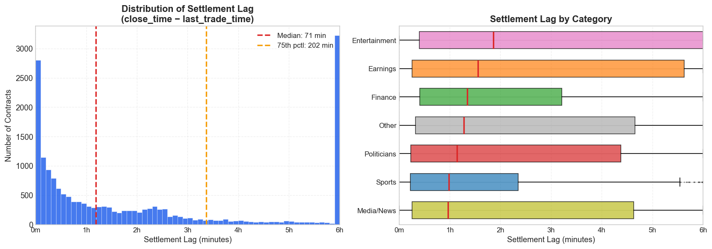
*Figure 1: Settlement lag (close_time minus last_trade_time) across all mention markets. The left panel shows the overall distribution with median and 75th percentile marked. The right panel breaks down the lag by category, revealing that some market types consistently settle much later than others.*

This gap matters because VWAP horizons must be anchored to a reference time. If anchored to settlement time, a "2-hour VWAP" would measure the average price of trades occurring more than 2 hours before Kalshi settled the market -- not 2 hours before trading actually stopped. For markets with large settlement gaps, all short-horizon VWAPs (10 minutes, 30 minutes, 1 hour) would collapse to identical values because all trades occurred before every cutoff.

In an earlier version of this analysis, VWAPs were anchored to `close_time`. This caused approximately 82% of markets to show `vwap_2h == vwap_10m`. After correcting the anchor to `last_trade_time`, only 17.7% of markets show this equality -- genuine cases where all trading ceased more than 2 hours before the final trade.

## Methodology

### VWAP Computation

For each resolved contract, we compute volume-weighted average prices at eight time horizons before the last trade:

**7 days, 3 days, 1 day, 6 hours, 2 hours, 1 hour, 30 minutes, 10 minutes**

Each VWAP is calculated as:

```
VWAP(horizon) = SUM(price * volume for trades before cutoff) / SUM(volume for trades before cutoff)
```

where the cutoff is `last_trade_time - horizon`. Only trades occurring strictly before the cutoff contribute to that horizon's VWAP. Prices are in cents (1--99), so a VWAP of 70 implies a 70% market-implied probability of YES resolution.

The 2-hour VWAP serves as the primary snapshot throughout the analysis. It offers a balance between recency (capturing late information) and stability (not dominated by a handful of final trades).

### Calibration Measurement

Calibration is assessed by grouping contracts into probability buckets based on their VWAP and comparing the bucket's average implied probability to the actual YES resolution rate within that bucket.

For each bucket of width `b` cents (typically 10):

1. Assign each contract to a bucket based on its VWAP (e.g., 0--10%, 10--20%, ..., 90--100%).
2. Compute the **actual YES rate** within the bucket: the fraction of contracts that resolved YES.
3. Compare to the bucket **midpoint** (the implied probability): 5%, 15%, 25%, ..., 95%.

A perfectly calibrated market produces points lying exactly on the 45-degree diagonal: contracts priced at 15% resolve YES 15% of the time.

### Mean Absolute Deviation (MAD)

To reduce calibration quality to a single number, we compute the Mean Absolute Deviation:

```
MAD = mean(|actual_yes_rate - implied_probability|) across all buckets with n >= 5
```

MAD is expressed in percentage points. A MAD of 0 indicates perfect calibration. A MAD of 10 means the market's prices deviate from true probabilities by an average of 10 percentage points across the probability spectrum. Buckets with fewer than 5 observations are excluded to avoid noise.

### Fee Structure

Kalshi charges taker fees according to:

```
fee = ceil(0.07 * p * (100 - p) / 100)
```

where `p` is the contract price in cents. This fee is maximized at p = 50 (fee = 1.75 cents, rounded to 2 cents) and approaches zero at the extremes. The declining fee near probability extremes is significant: it means the exchange takes a smaller cut precisely where calibration errors tend to be largest.

### Strategy Backtesting

Two threshold strategies are tested:

- **Buy YES**: Purchase YES contracts when the 2-hour VWAP exceeds a given threshold. The bet pays 100 cents if the contract resolves YES, and the cost is the entry price plus fees.
- **Buy NO**: Purchase NO contracts when the 2-hour VWAP falls below a given threshold. The bet pays 100 cents if the contract resolves NO, and the cost is `(100 - price)` plus fees.

Thresholds are tested at 10% intervals from 10% through 90%. Net PnL per trade is reported after deducting Kalshi taker fees.

## Findings

### Category-Level Calibration

The summary statistics reveal meaningful variation across categories:

| Category | Contracts | YES Rate | Directional Accuracy | MAD (2h) |
|----------|-----------|----------|---------------------|----------|
| Earnings | 2,118 | 57.4% | 88.5% | 12.1% |
| Entertainment | 1,228 | 32.3% | 92.6% | 16.4% |
| Finance | 559 | 39.0% | 86.6% | 11.6% |
| Media/News | 757 | 40.8% | 83.6% | 11.2% |
| Politicians | 7,320 | 44.9% | 83.6% | 9.5% |
| Sports | 5,383 | 52.0% | 87.3% | 11.9% |

**Directional accuracy** -- whether the 2-hour VWAP correctly predicts the outcome (above 50 = YES, below 50 = NO) -- exceeds 83% across all categories. Entertainment leads at 92.6%, though this partly reflects the category's low base rate (only 32.3% resolve YES): a strategy of always predicting NO would achieve 67.7% accuracy.

**Calibration quality (MAD)** tells a different story. Politicians have the lowest MAD at 9.5 percentage points, suggesting that the highest-volume category is also the best-calibrated. Entertainment has the worst calibration at 16.4% MAD despite having the highest directional accuracy -- a pattern consistent with systematic mispricing of low-probability contracts.

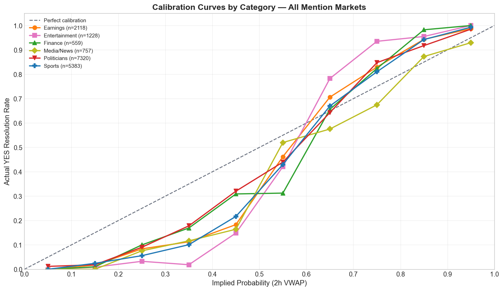
*Figure 2: Calibration curves by category using the 2-hour VWAP. Each point represents a 10-cent probability bucket. The dashed diagonal is perfect calibration. Deviations above the line indicate under-pricing (market too pessimistic); deviations below indicate over-pricing (market too optimistic).*

### Multi-Horizon Calibration

Examining calibration at multiple VWAP horizons reveals how each category's pricing accuracy evolves as the event approaches. The charts below show calibration curves at six time horizons -- from 1 day before the last trade down to 10 minutes -- for each of the four main categories.

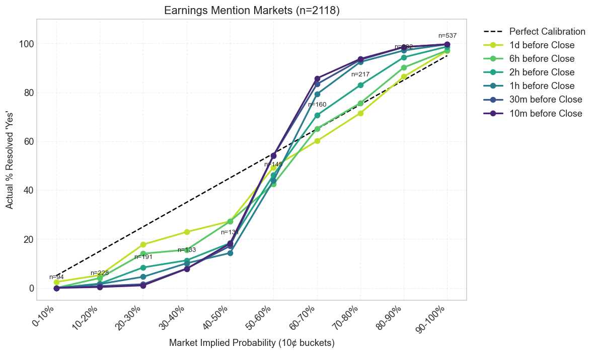
*Figure 3: Earnings mention markets -- calibration curves at six time horizons. The tighter clustering of curves at shorter horizons shows the market converging toward fair pricing as the earnings call progresses.*

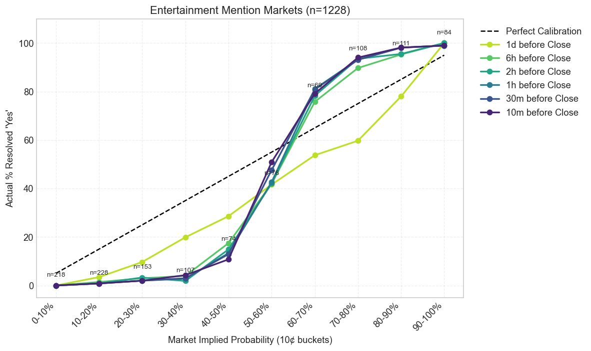
*Figure 4: Entertainment mention markets -- calibration across horizons. The persistent gap between the curves and the diagonal, even at the 10-minute mark, reflects this category's high MAD and systematic mispricing of low-probability contracts.*

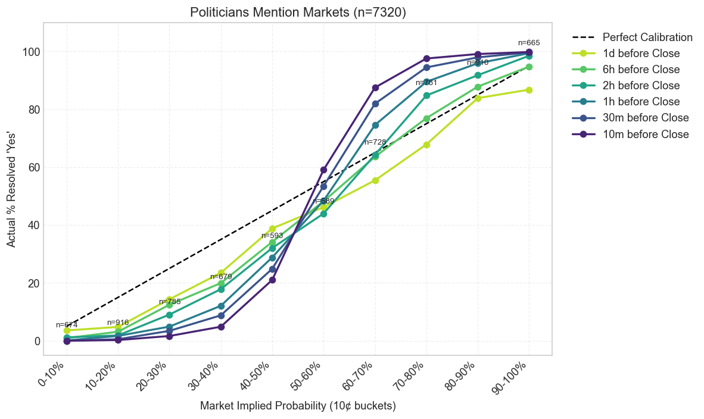
*Figure 5: Politicians mention markets -- the highest-volume and best-calibrated category. Curves converge tightly toward the diagonal at shorter horizons, consistent with deep liquidity enabling efficient price discovery.*

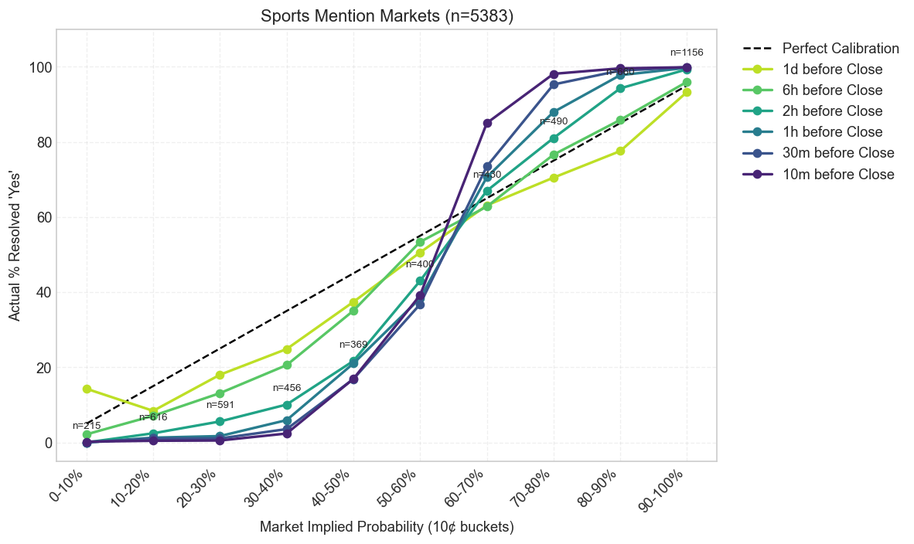
*Figure 6: Sports mention markets -- calibration across horizons. Sports markets achieve relatively good calibration early, likely because broadcast schedules and content are more predictable.*

### Temporal Convergence

All categories show improving calibration as the market approaches its final trade. MAD declines monotonically from the 1-day horizon to the 10-minute horizon across every category. This is the expected behavior in an informationally efficient market: prices incorporate new information as the event draws closer.

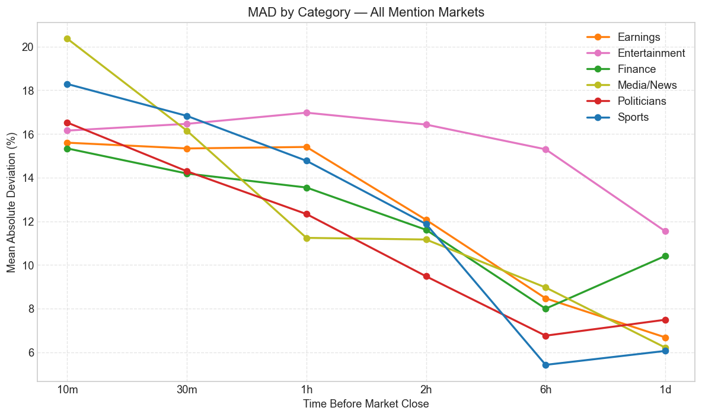
*Figure 7: Mean Absolute Deviation across time horizons for all six categories. Time runs from the longest horizon (1 day, left) to the shortest (10 minutes, right). All categories converge toward lower MAD, but the rate of improvement varies substantially.*

However, the rate of convergence varies. Some categories (notably Sports) achieve relatively tight calibration by the 6-hour mark, while others (Entertainment, Earnings) retain substantial MAD even at the 10-minute horizon. This suggests that information arrival patterns differ by domain -- sports outcomes may become more predictable earlier in the broadcast, while entertainment and earnings mentions may remain uncertain until the final minutes.

### Calibration Over Time

Beyond the question of how calibration improves within a single contract's lifetime, we can ask whether the market as a whole has become better-calibrated over the months of its existence. Using cumulative trade positions, we compute the rolling MAD at weekly intervals for each main category.

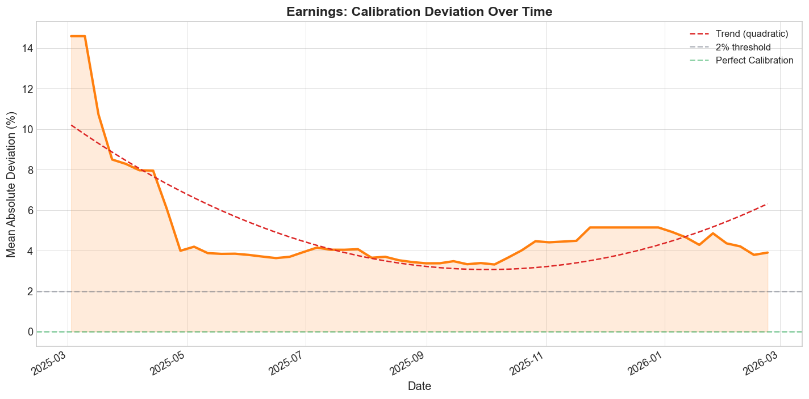
*Figure 8: Earnings -- cumulative calibration deviation over time. The trend line shows whether the market's pricing accuracy is improving or degrading as it matures.*

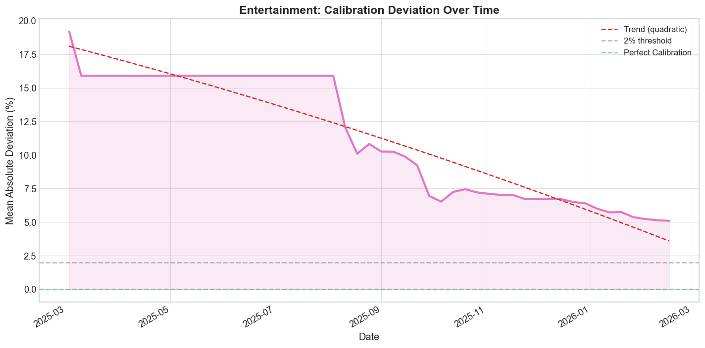
*Figure 9: Entertainment -- cumulative calibration deviation over time.*

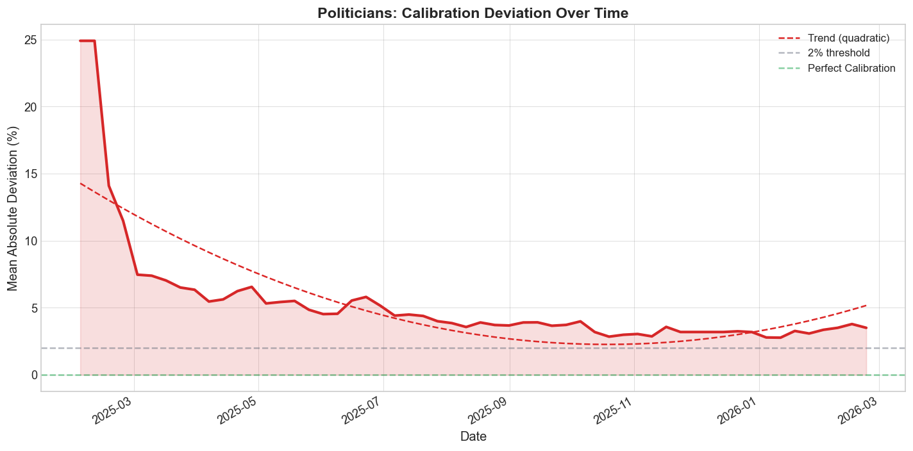
*Figure 10: Politicians -- cumulative calibration deviation over time. As the highest-volume category, Politicians show the most stable and gradually improving calibration.*

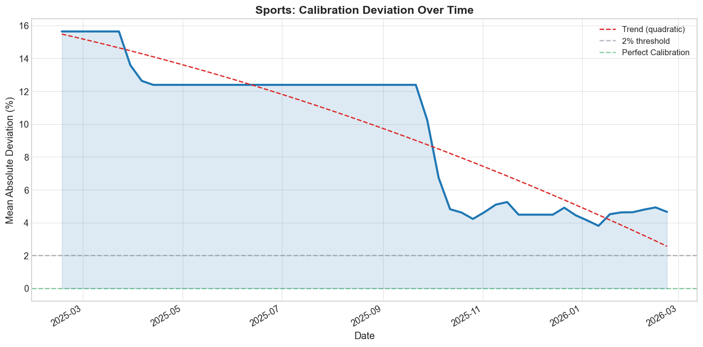
*Figure 11: Sports -- cumulative calibration deviation over time.*

### Strategy Profitability

The backtest reveals an asymmetry between YES and NO strategies:

**Buy YES** becomes profitable above the 50% threshold, peaking at the 70% level with an average net PnL of +5.0 cents per trade across 6,424 trades. Returns taper at the 90% threshold (+3.1 cents/trade) as the entry price leaves less room for profit despite a 98% hit rate.

**Buy NO** is profitable across all tested thresholds, with the strongest returns at the 40--50% level: +14.1 cents per trade at the <50% threshold across 8,152 trades. This reflects the persistent longshot bias -- low-probability contracts (priced cheaply) resolve NO more often than their price implies, making the NO side systematically underpriced.

The asymmetry is stark. The best Buy NO threshold (<50%) averages +14.1 cents per trade, nearly three times the best Buy YES threshold's +5.0 cents. This suggests that the dominant miscalibration in mention markets is on the low end of the probability spectrum: the market overestimates the likelihood that a word or phrase will be mentioned.

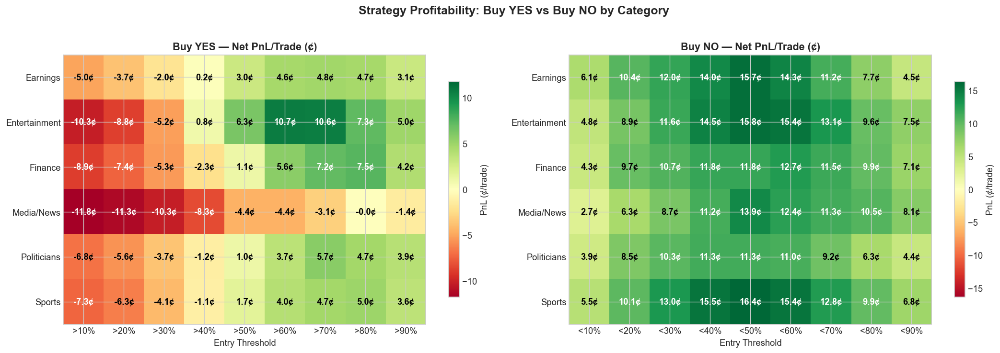
*Figure 12: Net PnL per trade (in cents) for Buy YES (left) and Buy NO (right) strategies across all categories and thresholds. Green cells indicate profitable strategies; red cells indicate losses. The NO side shows broadly positive returns, while the YES side is profitable only at higher thresholds.*

### VWAP Price Trajectories

The spaghetti plots below show the VWAP trajectory for every contract in each main category, from 7 days before the last trade down to 10 minutes. Green traces resolved YES; red traces resolved NO. These visualizations reveal the overall separation between outcomes and the characteristic "funnel" pattern as prices converge toward 0 or 100 near the event.

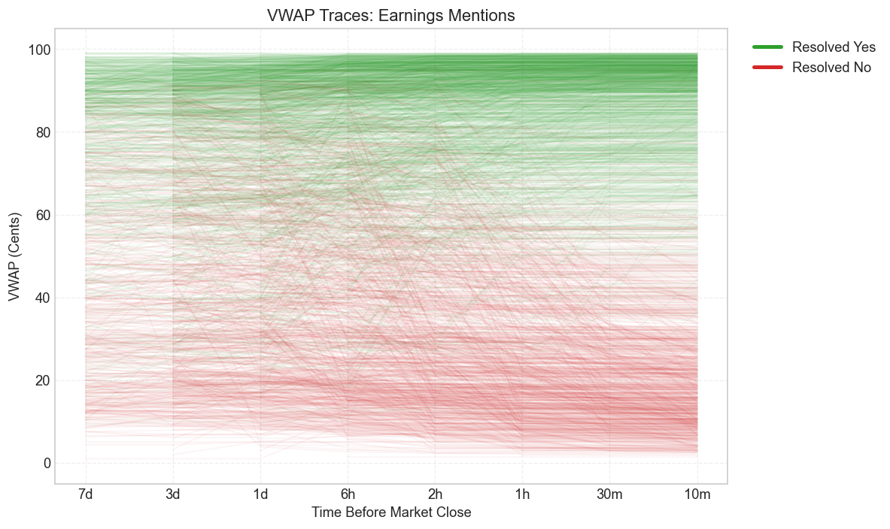
*Figure 13: Earnings -- individual contract VWAP trajectories. Each line is one contract. The separation between green (YES) and red (NO) traces widens as the event approaches, reflecting increasing market confidence.*

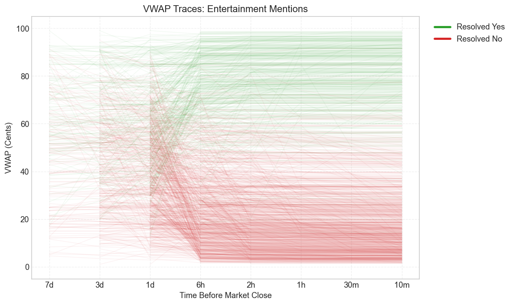
*Figure 14: Entertainment -- VWAP trajectories. The preponderance of red traces reflects the low YES rate (32.3%) in this category.*

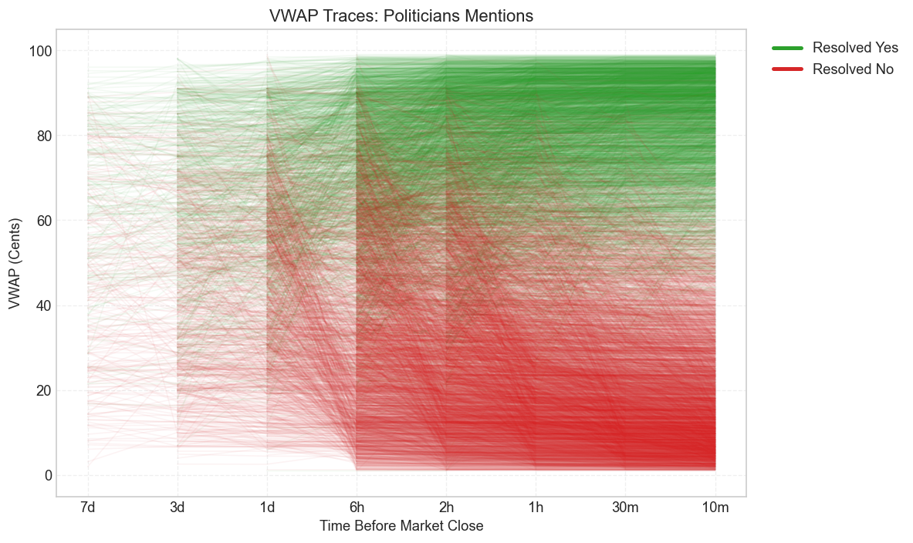
*Figure 15: Politicians -- VWAP trajectories. The dense mass of traces reflects the category's large contract count (7,320), with clear separation between outcomes emerging by the 2-hour mark.*

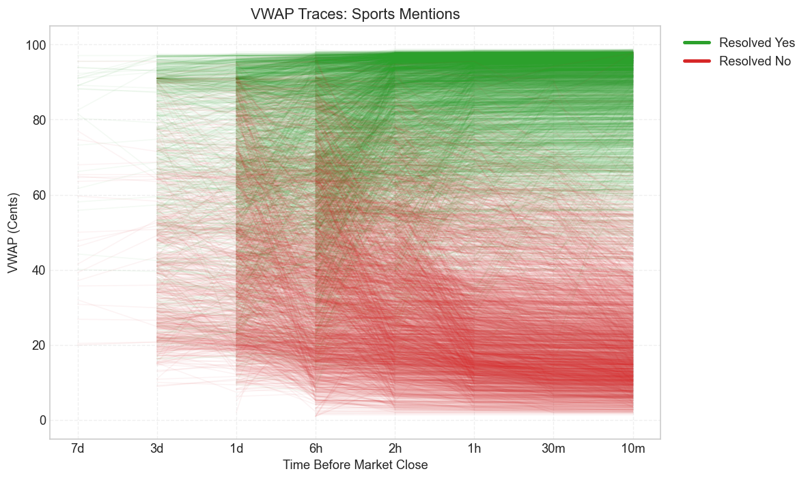
*Figure 16: Sports -- VWAP trajectories. The more balanced split between green and red traces is consistent with Sports' near-even YES rate (52.0%).*

### Category-Specific Opportunities

Profitability is not uniform across categories. The heatmap analysis reveals that some category-threshold combinations yield substantially higher returns than others. Entertainment and Earnings contracts show particularly large NO-side profits, consistent with their low YES rates and high MAD values. Politicians, despite having the best overall calibration, still offer positive returns at high YES thresholds due to the sheer volume of contracts available.

## Limitations

Several caveats apply to these findings:

- **In-sample only.** All results are computed on the full dataset without train/test splits. The patterns may not persist out of sample.
- **Correlated outcomes.** Multiple contracts within the same event (e.g., several mention bets on a single Trump rally) are not independent. The effective sample size for statistical inference is smaller than raw contract counts suggest.
- **Execution assumptions.** The backtest assumes fills at the 2-hour VWAP, which may not be achievable in practice. Large position sizes would move the order book, and the 2-hour VWAP is a retrospective snapshot, not a tradeable price.
- **Market evolution.** These markets are relatively new. Calibration errors may shrink as participants learn and liquidity deepens. The calibration-over-time analysis provides early evidence of this convergence.
- **Survivorship bias.** Only resolved contracts with recorded trades are analyzed. Markets that were delisted, cancelled, or had zero trading activity are excluded.
- **Maker fee advantage not modeled.** Kalshi charges zero fees for limit orders that provide liquidity. A more sophisticated strategy using resting limit orders would capture the same calibration edge while paying no fees, substantially improving returns beyond what is reported here.

## Conclusion

Kalshi's mention markets exhibit systematic miscalibration that varies meaningfully by category. The dominant pattern is a longshot bias: low-probability contracts overestimate the likelihood of a mention, creating persistent value on the NO side. This bias survives after accounting for Kalshi's taker fee schedule, which conveniently charges less at the probability extremes where the mispricing is largest.

The finding that Politicians -- the highest-volume category -- also shows the best calibration suggests that liquidity and participation depth contribute to price accuracy. Conversely, niche categories with fewer participants and less predictable content (Entertainment, Finance) show larger deviations from fair pricing.

Whether these patterns represent genuine alpha or an artifact of in-sample measurement remains an open question. The calibration-over-time analysis shows that the market has been improving, with MAD declining over the sample period. Traders and researchers should monitor whether these edges persist as the market matures.
