# Calibration Errors and Trading Opportunities in Kalshi Political Speech Mention Markets

## Introduction

Political speech is unpredictable. A rally can veer from trade policy to personal grievances in seconds. A press briefing can pivot from prepared remarks to an unexpected exchange about a trending news story. This unpredictability is precisely what makes political speech mention markets on Kalshi interesting from a calibration standpoint: how well can a crowd of traders anticipate whether a specific word or phrase will be uttered during a live event?

This article examines 7,320 resolved binary contracts across 32 political speech mention series on Kalshi, a CFTC-regulated prediction exchange (Kalshi Help Center; Wolfers and Zitzewitz 2004; Arrow et al. 2008). Each contract settles based on whether a particular word or phrase is mentioned during a scheduled political event -- a Trump rally, a White House press briefing, a mayoral debate. We divide these markets into four subgroups, measure calibration at multiple time horizons, and backtest simple threshold strategies that exploit the systematic biases we find -- all net of Kalshi's taker fee schedule.

The core finding: these markets exhibit a persistent longshot bias that survives after fees, with the NO side offering substantially stronger returns than the YES side. The market consistently overestimates the probability that a word will be mentioned.

## The Dataset

### Political Mention Markets on Kalshi

The dataset is drawn from the broader universe of Kalshi mention markets (18,948 total resolved contracts across all categories). We filter to the 7,320 contracts categorized as political speech mentions -- the single largest category, accounting for 39% of all mention market activity on the platform.

The underlying data consists of:

- **Trade records**: 4.7 million individual trade positions across political series, with timestamps (UTC), prices (in cents, 1--99), volumes, and taker side identification.
- **Market metadata**: Contract-level fields including ticker, series, title, result (yes/no), close time, and volume.

All VWAP computations are anchored to `last_trade_time` -- the timestamp of the final recorded trade per contract -- rather than `close_time` (when Kalshi settles and pays out). This distinction is critical: settlement lags the last trade by a median of 71 minutes across all mention markets, and anchoring to the wrong timestamp causes short-horizon VWAPs to collapse to identical values.

### Four Political Subgroups

The 32 political series are divided into four subgroups based on their content and market dynamics:

| Subgroup | Contracts | Description |
|----------|-----------|-------------|
| Trump Markets | 3,401 | `KXTRUMPMENTION` -- mentions during Trump rallies, press conferences, and public appearances. The highest-volume political series by a wide margin. |
| Press Briefings | 1,032 | `KXSECPRESSMENTION` -- White House Secretary of the Press daily briefing mentions. Notable for their regularity and predictable scheduling. |
| Mamdani / NYC Mayoral | 724 | `KXMAMDANIMENTION`, `KXNYCMAYORDEBATEMENTION` -- niche but active markets around the NYC mayoral race and Zohran Mamdani. |
| Niche / One-offs | 2,163 | All remaining political series: Biden, Vance, Sanders, AOC, Hegseth, Hochul, DeSantis, congressional hearings, and more. Individually small, collectively substantial. |

Trump Markets alone account for 46% of all political mention contracts. Combined with the Niche category, unscripted or semi-scripted events represent over 75% of the political dataset.

## Methodology

The analytical pipeline follows four stages:

### 1. VWAP Snapshots

For each resolved contract, we compute volume-weighted average prices at six time horizons before the last trade: **1 day, 6 hours, 2 hours, 1 hour, 30 minutes, and 10 minutes**. Each VWAP captures the market's implied probability at that point in time:

```
VWAP(horizon) = SUM(price * volume for trades before cutoff) / SUM(volume for trades before cutoff)
```

The 2-hour VWAP is the primary snapshot, balancing recency with statistical stability.

### 2. Calibration Curves

Contracts are grouped into probability buckets (at 1-cent, 5-cent, and 10-cent granularities) and the actual YES resolution rate within each bucket is compared to the bucket midpoint (cf. Page and Clemen 2013). Deviations from the 45-degree diagonal indicate systematic mispricing.

### 3. Mean Absolute Deviation (MAD)

Calibration quality is summarized as:

```
MAD = mean(|actual_yes_rate - implied_probability|) across buckets with n >= 5
```

Lower MAD indicates better calibration. This approach follows the calibration framework developed for prediction markets by Page and Clemen (2013), who also document the favorite-longshot bias as a function of time to expiration. We track MAD across time horizons to measure convergence speed.

### 4. Strategy Backtesting

Two threshold strategies are tested at 10% intervals from 10% through 90%:

- **Buy YES**: Purchase when VWAP > threshold. Pays 100 cents if YES, costs entry price + fees.
- **Buy NO**: Purchase when VWAP < threshold. Pays 100 cents if NO, costs (100 - price) + fees.

All returns are net of Kalshi's taker fee: `ceil(0.07 * p * (100 - p) / 100)` cents per contract.

## Findings

### The Market Is Learning -- But Still Biased

Before examining static calibration curves, it's worth asking whether these markets are improving over time. Using 4.7 million trade positions, we compute the cumulative mean absolute deviation at weekly intervals.

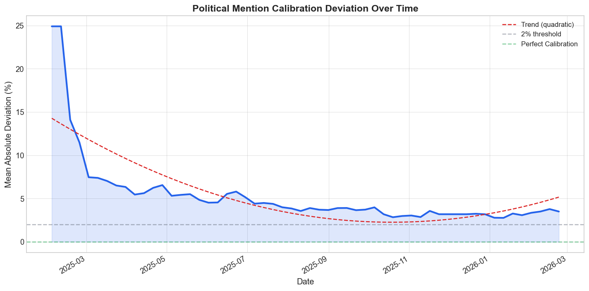
*Figure 1: Cumulative calibration deviation over time for all political mention markets. The blue area shows the rolling MAD, with a quadratic trend line (dashed red). Early weeks show MAD above 12%; recent weeks have converged below 4%.*

The trend is clear: calibration has improved substantially over the life of these markets. This convergence is consistent with broader evidence that prediction market informativeness varies with time horizon and trader composition (Page and Clemen 2013; Brown, Reade, and Vaughan Williams 2019).

- **Overall MAD**: 5.35 percentage points
- **Early period** (first 8 weeks): 12.97%
- **Recent period** (last 8 weeks): 3.26%
- **Trend**: -0.166 percentage points per week (improving)

This improvement likely reflects a combination of participant learning, increased liquidity, and the accumulation of historical data that traders can reference. However, even in the most recent period, a MAD of 3.26% indicates non-trivial residual miscalibration.

### Overall Calibration: The Longshot Bias

The aggregate calibration curve for all 7,320 political mention contracts reveals the classic favorite-longshot bias.

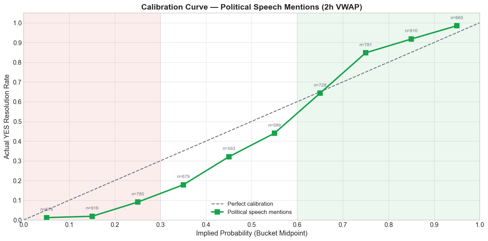
*Figure 2: Calibration curve for all political speech mentions using the 2-hour VWAP. The dashed diagonal represents perfect calibration. The red-shaded zone (0--30%) highlights where the market overestimates YES probability (longshot bias). The green-shaded zone (60--100%) highlights where the market underestimates YES probability (favorite bias).*

In the low-probability range (0--30 cents), contracts resolve YES less often than their price implies. These are the "longshots" -- bets on unlikely mentions that the market prices too generously. At the high end (60--100 cents), contracts resolve YES more frequently than implied -- the market is too pessimistic about near-certain mentions.

This pattern — the favorite-longshot bias — is one of the most extensively documented anomalies in betting markets, observed across horse racing, sports betting, and fixed-odds markets over more than fifty years of empirical study (Snowberg and Wolfers 2010). It has also been identified within prediction markets specifically, where prices in the low-probability range systematically overestimate the likelihood of the event occurring (Page and Clemen 2013). Bürgi, Deng, and Whelan (2025) document the same bias across Kalshi's full contract universe of over 300,000 contracts, including political markets. Our contribution is the subgroup decomposition and strategy backtesting within the political speech mention category specifically.

### Directional Accuracy by Subgroup

Before diving into calibration details, a simpler question: does the 2-hour VWAP even predict the right direction? If the VWAP exceeds 50 cents, we predict YES; otherwise NO.

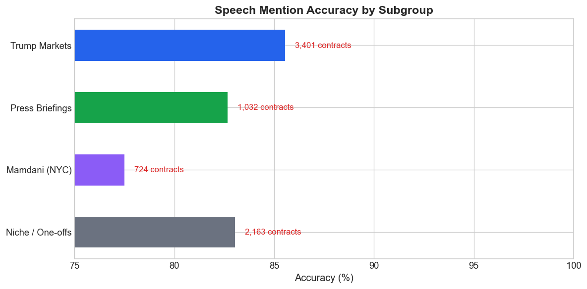
*Figure 3: Directional accuracy by subgroup. All four subgroups exceed 80%, with contract counts annotated to contextualize statistical reliability.*

All subgroups achieve directional accuracy well above the 50% chance baseline. The market has genuine predictive content -- the question is how precisely it calibrates, not whether it predicts at all.

### Subgroup Calibration Deep Dives

Each subgroup has distinct market dynamics that produce different calibration profiles. We examine calibration curves at three granularities (1-cent, 5-cent, and 10-cent buckets) across six VWAP horizons for each subgroup.

#### Trump Markets

`KXTRUMPMENTION`, 3,401 contracts. The most liquid political mention series. Despite deep liquidity, Trump markets exhibit some of the largest calibration errors at high implied probabilities. This likely reflects the genuine unpredictability of Trump's unscripted public appearances -- even a deep, active market struggles to price mentions during events where the speaker's content is inherently volatile.

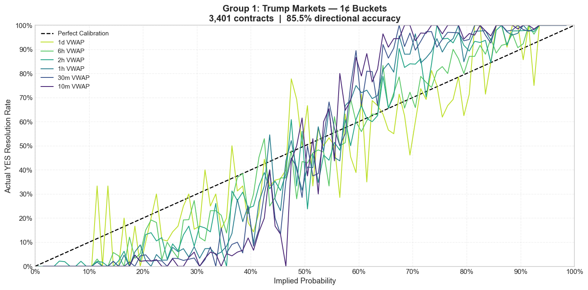
*Figure 4a: Trump Markets -- 1-cent bucket calibration across six VWAP horizons. The fine granularity reveals the noisy but systematic deviation from the diagonal, particularly in the 10--30% and 70--90% ranges.*

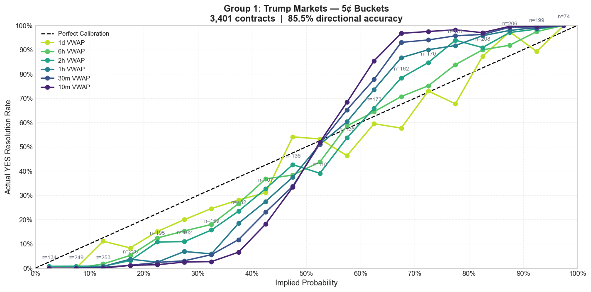
*Figure 4b: Trump Markets -- 5-cent buckets. Smoothing reduces noise and makes the longshot bias clearly visible: low-probability buckets fall below the diagonal, high-probability buckets rise above it.*

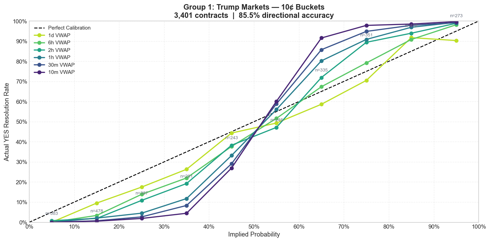
*Figure 4c: Trump Markets -- 10-cent buckets. The coarsest view confirms the S-shaped calibration pattern, with sample sizes (n=) annotated on the 2-hour VWAP line.*

#### Press Briefings

`KXSECPRESSMENTION`, 1,032 contracts. White House press briefings follow a more predictable structure than rallies. The constrained vocabulary and recurring format should, in theory, produce tighter calibration. These markets test whether routine, scheduled events are priced more efficiently than ad-hoc speeches.

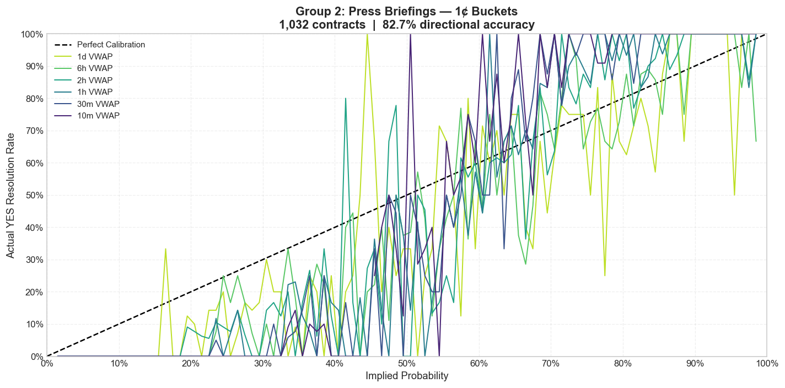
*Figure 5a: Press Briefings -- 1-cent bucket calibration. The more predictable event format produces somewhat tighter clustering around the diagonal compared to Trump Markets.*

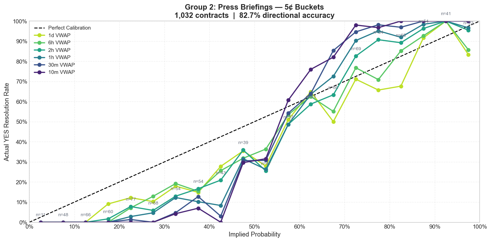
*Figure 5b: Press Briefings -- 5-cent buckets.*

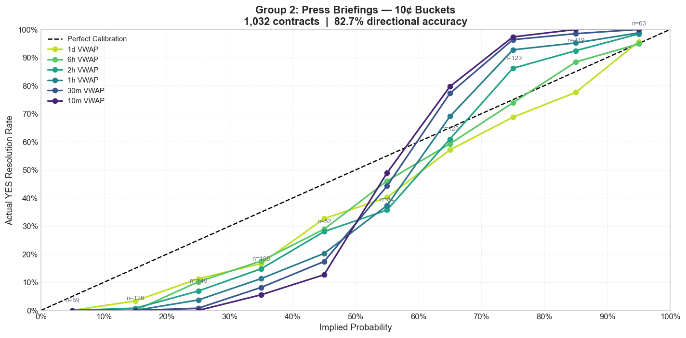
*Figure 5c: Press Briefings -- 10-cent buckets. With 1,032 contracts, some buckets have limited sample sizes, particularly at the extremes.*

#### Mamdani / NYC Mayoral

`KXMAMDANIMENTION`, `KXNYCMAYORDEBATEMENTION`, 724 contracts. A niche market with lower national profile and thinner liquidity. The smaller participant pool creates conditions where larger calibration errors are expected -- and potentially more exploitable.

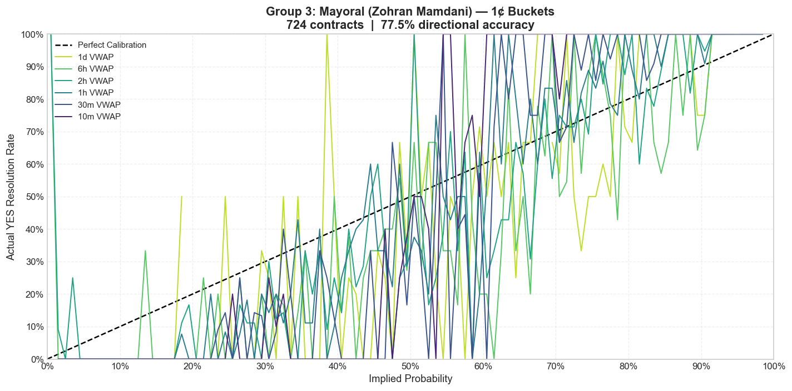
*Figure 6a: Mamdani / NYC Mayoral -- 1-cent bucket calibration. The noisier curves reflect the thinner liquidity and fewer contracts in this subgroup.*

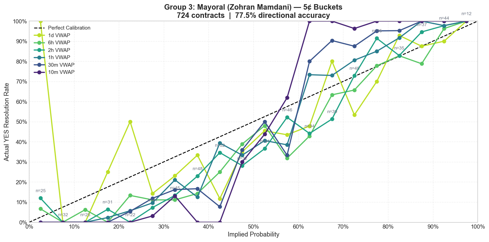
*Figure 6b: Mamdani / NYC Mayoral -- 5-cent buckets. Despite the smaller sample, the longshot bias pattern is still visible.*

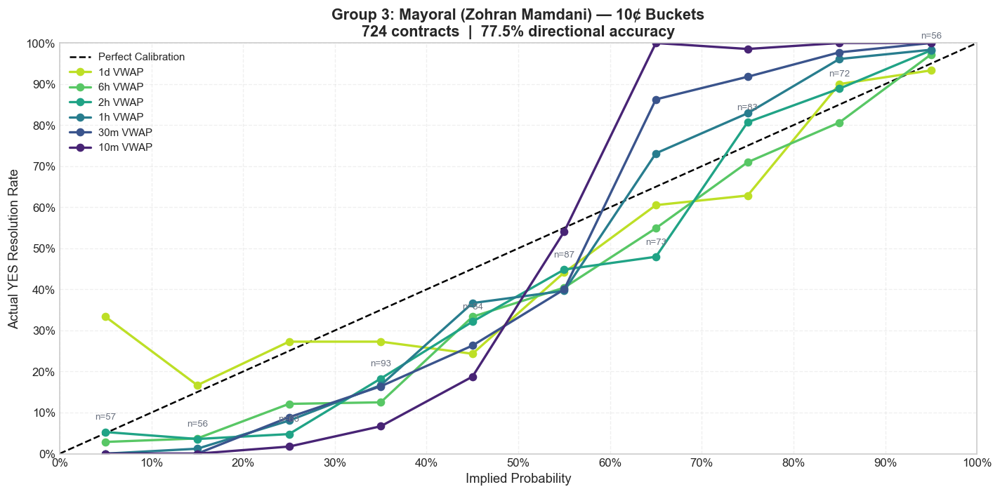
*Figure 6c: Mamdani / NYC Mayoral -- 10-cent buckets. Limited sample sizes in some buckets warrant caution when interpreting the calibration curve shape.*

#### Niche / One-offs

2,163 contracts across the long tail of political mention series -- Biden, Vance, Sanders, AOC, and dozens more. Individually each series has limited data, but in aggregate they reveal whether the calibration patterns in high-volume series generalize.

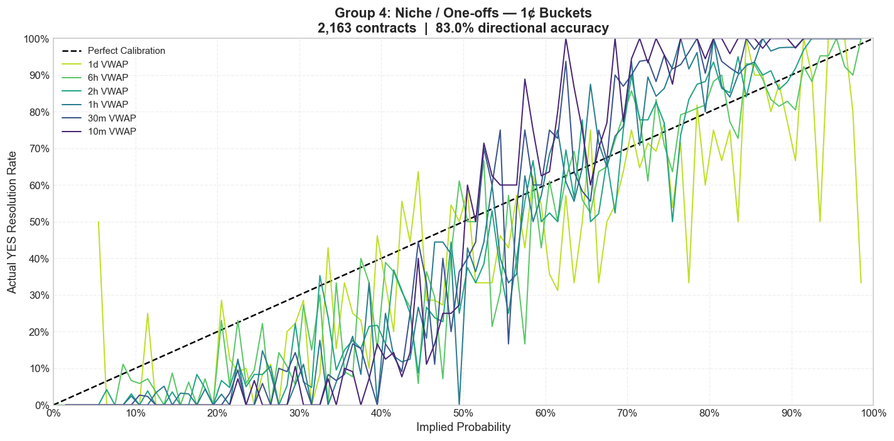
*Figure 7a: Niche / One-offs -- 1-cent bucket calibration. The aggregation across many diverse series produces a curve that tracks the diagonal more closely than any individual niche series would.*

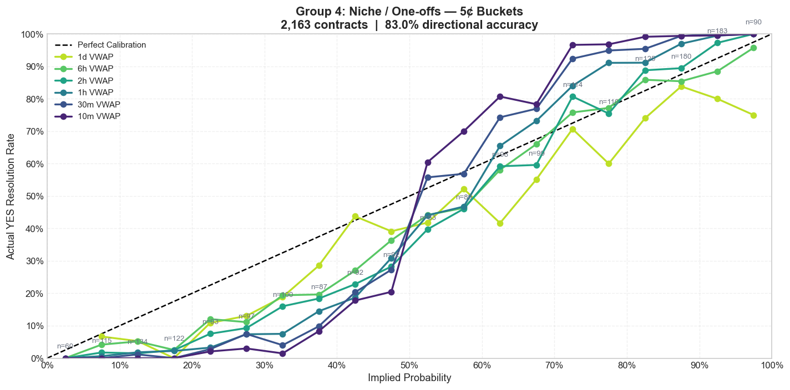
*Figure 7b: Niche / One-offs -- 5-cent buckets.*

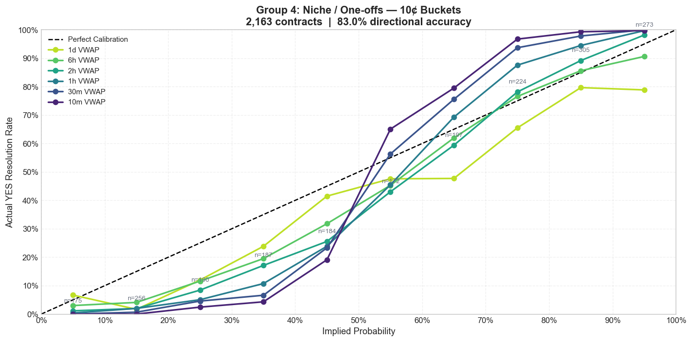
*Figure 7c: Niche / One-offs -- 10-cent buckets. The familiar longshot bias pattern persists in the long tail, confirming it is not unique to the high-volume Trump or Press Briefing series.*

### VWAP Price Trajectories

The spaghetti plots below trace every contract's VWAP from 7 days before the last trade down to 10 minutes. Green lines resolved YES; red lines resolved NO.

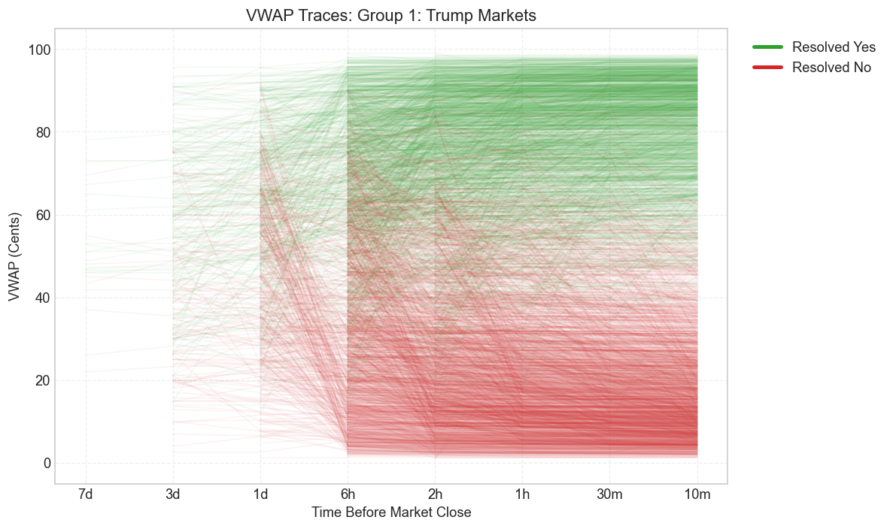
*Figure 8: Trump Markets -- individual contract VWAP trajectories. The characteristic "funnel" pattern shows prices converging toward 0 or 100 as the event approaches, with clear separation between YES (green) and NO (red) outcomes emerging by the 2-hour mark.*

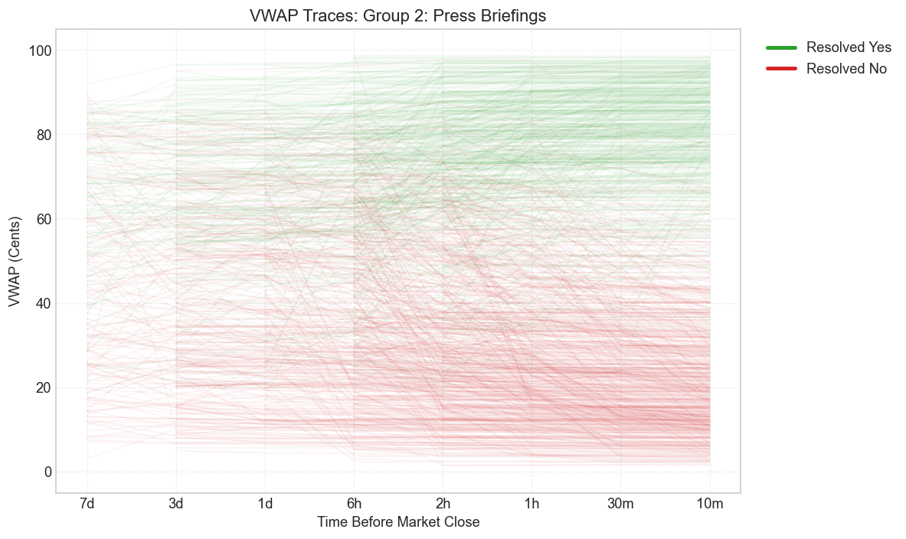
*Figure 9: Press Briefings -- VWAP trajectories. The tighter initial clustering compared to Trump Markets reflects the more predictable nature of briefing content.*

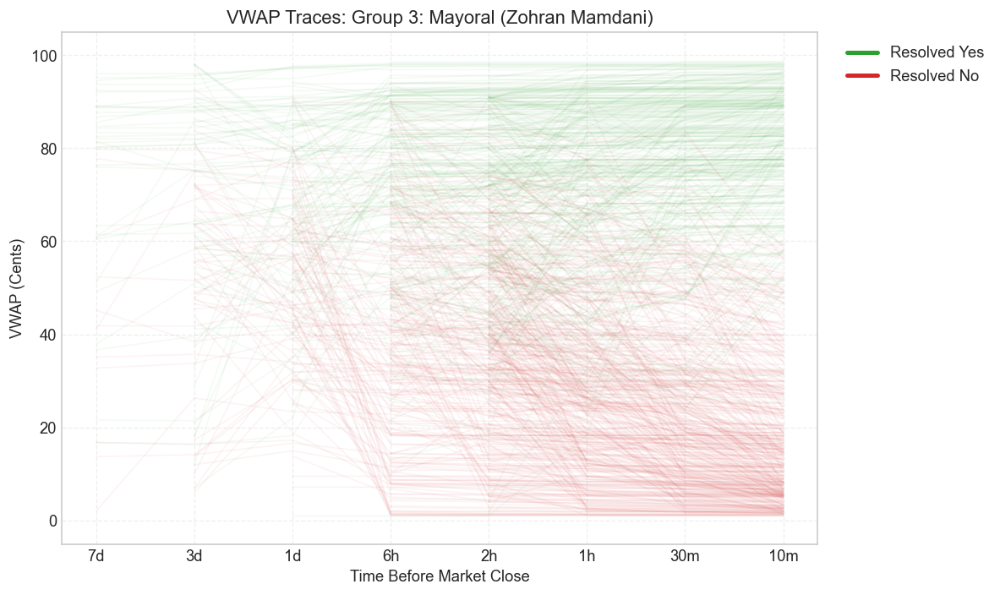
*Figure 10: Mamdani / NYC Mayoral -- VWAP trajectories. With fewer contracts, individual traces are more visible. The separation between outcomes is less crisp than in higher-volume subgroups.*

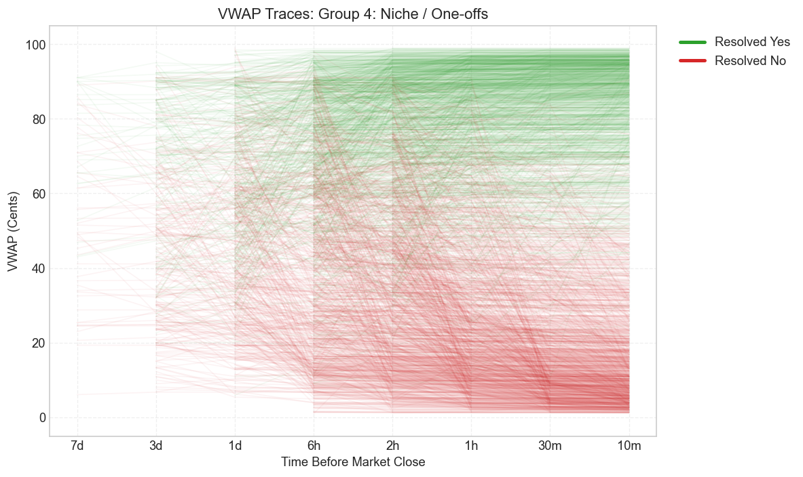
*Figure 11: Niche / One-offs -- VWAP trajectories. The diverse mix of series produces a broader spread of price paths, with some contracts showing late-breaking price movements near the event.*

### Temporal Convergence: MAD Across Horizons

How quickly does each subgroup converge toward fair pricing as the event approaches?

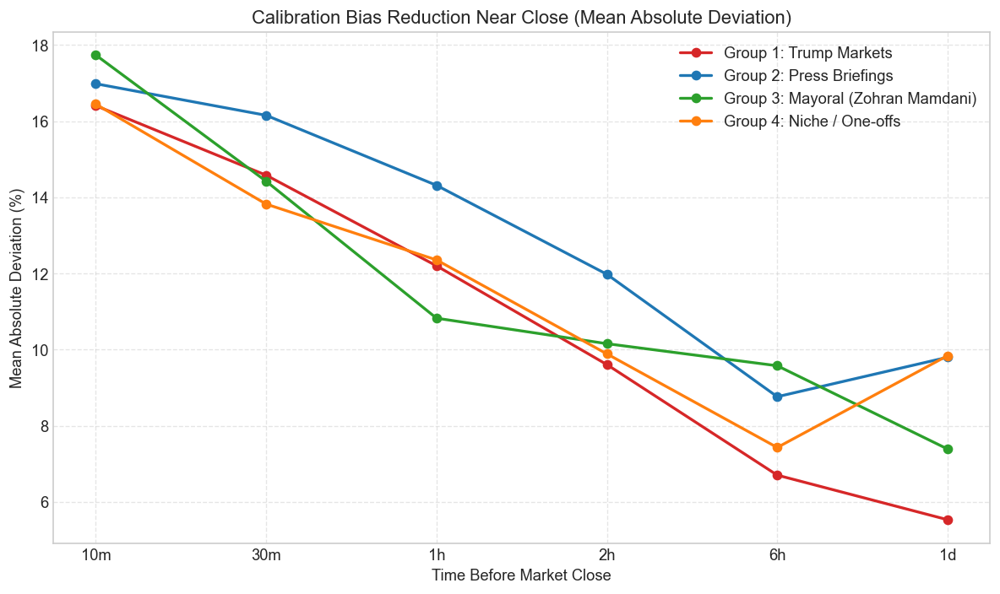
*Figure 12: Mean Absolute Deviation by subgroup across six time horizons, from 1 day (left) to 10 minutes (right). All subgroups show declining MAD, but the rate and final level vary.*

All four subgroups follow the expected pattern: MAD declines as the event nears. But the details reveal important differences:

- **Trump Markets** start with relatively high MAD at the 1-day horizon (reflecting genuine uncertainty about rally content) but converge substantially by the 1-hour mark.
- **Press Briefings** show a flatter curve -- calibration is more consistent across horizons, likely because briefing content is more predictable even days in advance.
- **Mamdani** shows the most volatile MAD trajectory, consistent with thinner liquidity and fewer participants driving price discovery.
- **Niche / One-offs** track a middle path, with the aggregation across many series smoothing out individual volatility.

Even at the 10-minute horizon, non-trivial miscalibration remains across all subgroups. This residual error represents the irreducible uncertainty of live speech events combined with thin late-market liquidity.

### Strategy Profitability: Buy YES vs Buy NO

The central practical question: can these calibration errors be exploited profitably after Kalshi's taker fees?

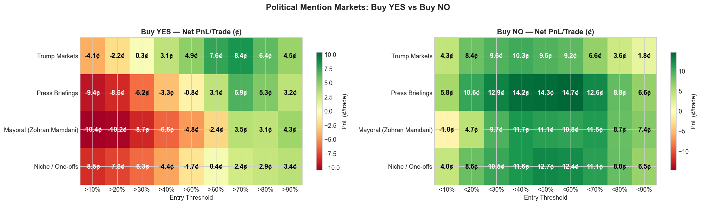
*Figure 13: Net PnL per trade (in cents) for Buy YES (left) and Buy NO (right) strategies across all four subgroups and nine threshold levels. Green cells indicate profitable strategies; red cells indicate losses.*

The results are striking:

**Buy YES strategy (political averages):**

| Threshold | Trades | Avg PnL/Trade | Hit Rate |
|-----------|--------|---------------|----------|
| >50% | 3,673 | -0.6 cents | 76% |
| >60% | 3,084 | +2.2 cents | 83% |
| >70% | 2,356 | +5.3 cents | 91% |
| >80% | 1,575 | +4.4 cents | 94% |
| >90% | 665 | +3.9 cents | 98% |

**Buy NO strategy (political averages):**

| Threshold | Trades | Avg PnL/Trade | Hit Rate |
|-----------|--------|---------------|----------|
| <20% | 1,589 | +8.1 cents | 98% |
| <30% | 2,370 | +10.7 cents | 96% |
| <40% | 3,050 | +12.0 cents | 93% |
| <50% | 3,644 | +11.9 cents | 88% |
| <60% | 4,236 | +11.8 cents | 84% |

The asymmetry is stark. Buy NO generates positive returns across every threshold tested, peaking at +12.0 cents per trade at the <40% level. Buy YES only becomes profitable above 60%, peaking at +5.3 cents at the 70% threshold -- less than half the NO side's best.

This reflects the longshot bias in action: the market systematically overprices the YES side of low-probability contracts. Buying NO exploits this mispricing, and the fee structure helps -- Kalshi's taker fee declines near the probability extremes, precisely where the edge is largest.

### Trump Markets Deep Dive

As the highest-volume subgroup with 3,401 contracts, Trump Markets warrant individual examination.

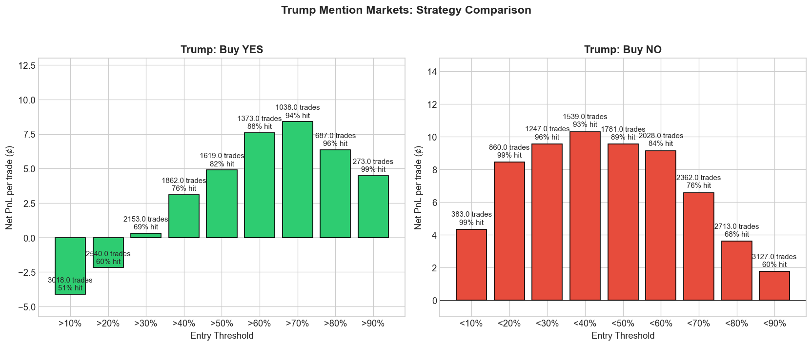
*Figure 14: Trump mention markets -- net PnL per trade for Buy YES (green, left) and Buy NO (red, right) strategies. Trade counts and hit rates are annotated above each bar.*

The Trump-specific results mirror the aggregate pattern but with amplified effects. The NO side is consistently profitable, and the YES side becomes profitable at higher thresholds. The large contract count (3,401) provides statistical confidence that these are not small-sample artifacts.

## Discussion

### Why Political Speech Markets Are Miscalibrated

Several features of political speech markets contribute to their persistent miscalibration:

1. **Content unpredictability.** Unlike sports broadcasts (where the set of likely mentions is constrained by the game) or earnings calls (where the agenda is largely predetermined), political speeches -- especially rallies and press conferences -- can cover virtually any topic. This makes it harder for traders to form accurate probability estimates.

2. **Asymmetric information.** Some participants may have advance knowledge of speech topics (e.g., staffers, journalists with leaked talking points). This creates adverse selection: uninformed traders may systematically overprice longshot mentions, while informed traders extract value on the other side. The behavioral mechanism underlying this overpricing is well-established: prospect theory's probability weighting function predicts that individuals systematically overweight small probabilities and underweight large ones (Kahneman and Tversky 1979), and Snowberg and Wolfers (2010) find empirical support for the view that probability misperception — rather than risk-loving preferences — drives the favorite-longshot bias.

3. **Entertainment-driven trading.** Political mention markets attract participants who are watching events for entertainment rather than profit. These traders may overweight salient or exciting mention possibilities (e.g., "Will Trump mention [controversial topic]?"), inflating prices above fair value. This is consistent with evidence that less information-driven order flow can temporarily reduce price efficiency in prediction markets (Brown, Reade, and Vaughan Williams 2019).

4. **Thin late-market liquidity.** Even for the most liquid series (Trump), order books thin out in the final minutes before an event. This prevents the late-arriving information that would correct mispricing from being fully incorporated into prices. More generally, liquidity does not automatically improve price efficiency; in some prediction markets, naive liquidity provision can slow the incorporation of information into prices (Tetlock 2008).

### The Fee Structure as Tailwind

Kalshi's taker fee formula (Kalshi Fee Schedule 2026; `ceil(0.07 * p * (100 - p) / 100)`) creates a concave fee curve that peaks at p = 50 and declines toward both extremes. At p = 10 (a cheap longshot), the fee is just 1 cent. At p = 90, the fee is also just 1 cent.

This is significant because the largest calibration errors occur precisely at these extremes. A strategy that buys NO on contracts priced below 30 cents pays minimal fees while capturing meaningful mispricing. The exchange's fee structure, designed to encourage trading, inadvertently subsidizes the exploitation of calibration errors.

A maker strategy using resting limit orders — which avoid taker fees in markets where maker fees do not apply (Kalshi Help Center, "Limit Orders"; Kalshi Fee Schedule 2026) — would amplify this advantage further. The same calibration edge with zero transaction costs would produce substantially higher net returns.

## Limitations

- **In-sample only.** All results are computed on the full dataset without train/test splits. The improving calibration trend (Section 2) suggests that historical patterns may not persist at the same magnitude.
- **Correlated outcomes.** Multiple contracts within the same event (e.g., 20+ mention bets on a single Trump rally) are not independent. The effective sample size is smaller than the 7,320 contract count suggests.
- **Execution assumptions.** The backtest assumes fills at the 2-hour VWAP, which is a retrospective snapshot. In practice, achieving this price requires being present in the market 2+ hours before the last trade, and larger position sizes would move the order book.
- **Market evolution.** The calibration-over-time analysis shows improvement from ~13% MAD to ~3% MAD. If this trend continues, the trading edge documented here may shrink or disappear. Bürgi, Deng, and Whelan (2025) raise a similar question about whether the biases they document in Kalshi's broader contract universe will persist now that they have been publicly identified, consistent with the general pattern that financial market anomalies tend to attenuate after publication.
- **Survivorship bias.** Only resolved contracts with recorded trades are analyzed. Cancelled or zero-activity markets are excluded.

## Conclusion

Kalshi's political speech mention markets exhibit a persistent longshot bias: the market overestimates the probability that a word or phrase will be mentioned during live political events. This mispricing is strongest in the 5--30 cent range and creates consistent value on the NO side -- betting that the mention will *not* occur.

Simple threshold strategies exploiting this bias generate positive returns after Kalshi's taker fees. The Buy NO strategy at the <40% threshold averages +12.0 cents per trade across 3,050 trades, while the best Buy YES strategy (>70%) averages +5.3 cents across 2,356 trades. The fee structure helps: Kalshi charges less at the probability extremes where the mispricing is concentrated.

The market is improving. Calibration deviation has declined from nearly 13% in the early weeks to roughly 3% in the most recent period, at a rate of -0.17 percentage points per week. This convergence suggests that participants are learning, but the residual miscalibration -- even in the most liquid subgroup (Trump Markets) -- indicates that structural features of political speech prediction (content unpredictability, entertainment-driven trading, thin late liquidity) prevent full price discovery.

For traders, the implication is a window of opportunity that is narrowing but not yet closed. For market designers, the persistent bias suggests that liquidity incentives and contract design innovations could improve price accuracy. For researchers, these markets offer a natural laboratory for studying how crowds price fundamentally unpredictable events.

## References

Arrow, K.J., Forsythe, R., Gorham, M., Hahn, R., Hanson, R., et al. (2008). "The Promise of Prediction Markets." *Science*, 320(5878), 877–878. https://doi.org/10.1126/science.1157679

Brown, A., Reade, J.J., & Vaughan Williams, L. (2019). "When Are Prediction Market Prices Most Informative?" *International Journal of Forecasting*, 35(1), 420–428. https://doi.org/10.1016/j.ijforecast.2018.07.012

Bürgi, C., Deng, W., & Whelan, K. (2025). "Makers and Takers: The Economics of the Kalshi Prediction Market." CESifo Working Paper No. 12122. https://ssrn.com/abstract=5502658

Kahneman, D. & Tversky, A. (1979). "Prospect Theory: An Analysis of Decision under Risk." *Econometrica*, 47(2), 263–291. https://doi.org/10.2307/1914185

Kalshi. (2026). "Fee Schedule." https://kalshi.com/docs/kalshi-fee-schedule.pdf

Kalshi Help Center. "How is Kalshi regulated?" https://help.kalshi.com/en/articles/13823765-how-is-kalshi-regulated

Kalshi Help Center. "Limit Orders." https://help.kalshi.com/en/articles/13823811-limit-orders

Page, L. & Clemen, R.T. (2013). "Do Prediction Markets Produce Well-Calibrated Probability Forecasts?" *Economic Journal*, 123(568), 491–513. https://doi.org/10.1111/j.1468-0297.2012.02561.x

Snowberg, E. & Wolfers, J. (2010). "Explaining the Favorite–Long Shot Bias: Is It Risk-Love or Misperceptions?" *Journal of Political Economy*, 118(4), 723–746. https://doi.org/10.1086/655844

Tetlock, P.C. (2008). "Liquidity and Prediction Market Efficiency." SSRN Working Paper. https://ssrn.com/abstract=929916

Wolfers, J. & Zitzewitz, E. (2004). "Prediction Markets." *Journal of Economic Perspectives*, 18(2), 107–126. https://doi.org/10.1257/0895330041371321
