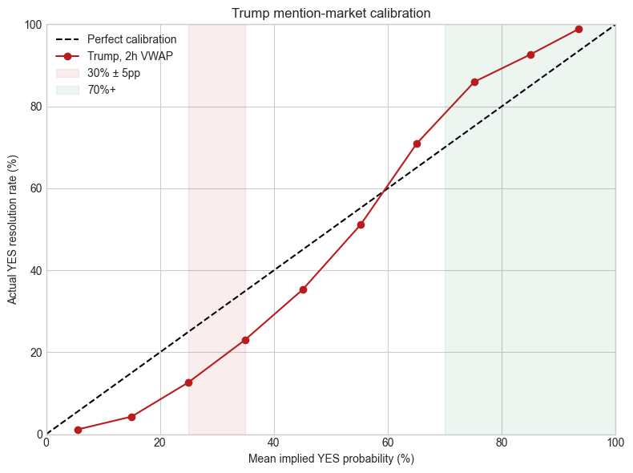

# Trump mention-market long-shot bias validation (2026-09-04 comparison snapshot)

> **Historical comparison:** this notebook is an executed broad T7 snapshot retained for auditability. It is not the canonical current result. The refreshed October 2 audit and consolidated claim ledger are in [mention-markets-validation-consolidated.ipynb](mention-markets-validation-consolidated.ipynb) and [mention-markets-validation-report.md](mention-markets-validation-report.md).

This reproducible notebook re-runs the project’s VWAP and calibration pipeline on the current T7 snapshot and tests the claim that:

- contracts priced near 30% resolve **YES less often** than 30%; and
- contracts priced at 70% or more resolve **YES more often** than their price implies.

The primary estimate uses the 2-hour VWAP before the final recorded trade, with sensitivity checks at 1 hour, 30 minutes, and 10 minutes. The notebook also uses event-cluster bootstrap intervals because many contracts belong to the same speech and are not independent observations.

Sources: the repository code in `src/`, the T7 drive at `/Volumes/T7/mention-markets`, and the two essays [Political Mention Market Calibration](https://lfpmb.com/articles/political-mention-market-calibration) and [Cross-Category Calibration Analysis](https://lfpmb.com/articles/cross-category-calibration-analysis).


```python
from pathlib import Path
import sys
import math
import numpy as np
import pandas as pd
import matplotlib.pyplot as plt
from IPython.display import display

# Run from the repository root, or adjust this path when opening the notebook elsewhere.
REPO = Path.cwd()
if not (REPO / "src").exists():
    REPO = Path("/Users/lfpmb/Documents/mention-analysis")
sys.path.insert(0, str(REPO))

from src.data_loading import load_markets, load_mention_markets
from src.metrics import strategy_profits

plt.style.use("seaborn-v0_8-whitegrid")
OUTPUT = REPO / "output" / "trump-longshot-bias-validation_files"
OUTPUT.mkdir(parents=True, exist_ok=True)
```

## 1. Data inventory and provenance

The loader ignores macOS `._*.parquet` sidecars and computes VWAPs relative to each market’s final recorded trade. This is a historical broad-snapshot comparison; contracts without `yes`/`no` outcomes are excluded from calibration.


```python
MARKET_ROOT = Path("/Volumes/T7/mention-markets")
market_files = sorted(p for p in (MARKET_ROOT / "markets").glob("*.parquet") if not p.name.startswith("._"))
trade_files = sorted(p for p in (MARKET_ROOT / "trades").glob("*.parquet") if not p.name.startswith("._"))

markets_raw = load_markets()
vwap_all = load_mention_markets()

inventory = pd.DataFrame({
    "measure": ["market parquet files", "trade parquet files", "raw market rows", "raw resolved rows", "VWAP rows", "VWAP rows with 2h value", "raw series values"],
    "value": [len(market_files), len(trade_files), len(markets_raw), int(markets_raw.result.isin(["yes", "no"]).sum()), len(vwap_all), int(vwap_all.vwap_2h.notna().sum()), int(markets_raw.series.nunique())],
})
display(inventory)
print("Raw market date range:", markets_raw.close_time.min(), "to", markets_raw.close_time.max())
print("VWAP date range:", vwap_all.close_time.min(), "to", vwap_all.close_time.max())
```


**Output**


<table border="1" class="dataframe">
  <thead>
    <tr style="text-align: right;">
      <th></th>
      <th>measure</th>
      <th>value</th>
    </tr>
  </thead>
  <tbody>
    <tr>
      <th>0</th>
      <td>market parquet files</td>
      <td>141</td>
    </tr>
    <tr>
      <th>1</th>
      <td>trade parquet files</td>
      <td>141</td>
    </tr>
    <tr>
      <th>2</th>
      <td>raw market rows</td>
      <td>38450</td>
    </tr>
    <tr>
      <th>3</th>
      <td>raw resolved rows</td>
      <td>36214</td>
    </tr>
    <tr>
      <th>4</th>
      <td>VWAP rows</td>
      <td>21975</td>
    </tr>
    <tr>
      <th>5</th>
      <td>VWAP rows with 2h value</td>
      <td>20979</td>
    </tr>
    <tr>
      <th>6</th>
      <td>raw series values</td>
      <td>143</td>
    </tr>
  </tbody>
</table>


```text
Raw market date range: 2025-01-30 12:55:29.003392-08:00 to 2026-08-08 07:00:00-07:00
VWAP date range: 2025-01-30 12:55:29.003392-08:00 to 2026-07-05 12:09:59-07:00
```

## 2. Canonicalize the Trump universe

The broad metadata has three `series` values for Trump contracts: `KXTRUMPMENTION`, `A`, and `B`. The ticker prefix is the stable identifier, so this comparison selects `ticker.startswith("KXTRUMPMENTION")`. The manifest-backed refreshed audit in the consolidated notebook is the primary current estimate.


```python
trump_meta = markets_raw.loc[
    markets_raw.ticker.astype(str).str.startswith("KXTRUMPMENTION")
    & markets_raw.result.isin(["yes", "no"])
].copy()

trump = vwap_all.merge(
    markets_raw[["ticker", "event_ticker", "title", "status", "series", "result", "close_time"]],
    on="ticker",
    how="inner",
    suffixes=("", "_meta"),
)
trump = trump.loc[trump.ticker.astype(str).str.startswith("KXTRUMPMENTION")].copy()
trump["actual_yes"] = trump["result"].eq("yes")
trump["event_ticker"] = trump["event_ticker"].fillna(trump["ticker"].str.rsplit("-", n=1).str[0])
trump["p_2h"] = trump["vwap_2h"]

series_audit = (
    trump_meta.groupby("series", dropna=False)
    .agg(raw_markets=("ticker", "size"), resolved=("result", lambda s: s.isin(["yes", "no"]).sum()))
    .reset_index()
)
valid_trump = trump.dropna(subset=["p_2h"]).copy()
summary = pd.DataFrame({
    "measure": ["raw Trump rows", "raw resolved Trump rows", "resolved Trump rows with 2h VWAP", "distinct events", "YES rate"],
    "value": [len(markets_raw.loc[markets_raw.ticker.astype(str).str.startswith("KXTRUMPMENTION")]), len(trump_meta), len(valid_trump), valid_trump.event_ticker.nunique(), valid_trump.actual_yes.mean()],
})
display(series_audit)
display(summary)
```


**Output**


<table border="1" class="dataframe">
  <thead>
    <tr style="text-align: right;">
      <th></th>
      <th>series</th>
      <th>raw_markets</th>
      <th>resolved</th>
    </tr>
  </thead>
  <tbody>
    <tr>
      <th>0</th>
      <td>A</td>
      <td>1267</td>
      <td>1267</td>
    </tr>
    <tr>
      <th>1</th>
      <td>B</td>
      <td>460</td>
      <td>460</td>
    </tr>
    <tr>
      <th>2</th>
      <td>KXTRUMPMENTION</td>
      <td>4814</td>
      <td>4814</td>
    </tr>
  </tbody>
</table>


<table border="1" class="dataframe">
  <thead>
    <tr style="text-align: right;">
      <th></th>
      <th>measure</th>
      <th>value</th>
    </tr>
  </thead>
  <tbody>
    <tr>
      <th>0</th>
      <td>raw Trump rows</td>
      <td>6745.000000</td>
    </tr>
    <tr>
      <th>1</th>
      <td>raw resolved Trump rows</td>
      <td>6541.000000</td>
    </tr>
    <tr>
      <th>2</th>
      <td>resolved Trump rows with 2h VWAP</td>
      <td>6352.000000</td>
    </tr>
    <tr>
      <th>3</th>
      <td>distinct events</td>
      <td>260.000000</td>
    </tr>
    <tr>
      <th>4</th>
      <td>YES rate</td>
      <td>0.436241</td>
    </tr>
  </tbody>
</table>

## 3. Data-quality checks

These checks establish the analysis grain and identify missingness or timestamp anomalies. `close_time - last_trade_time` is a trading-stop diagnostic here, not a payout lag; the refreshed audit reports `settlement_ts` separately.


```python
horizons = ["7d", "3d", "1d", "6h", "2h", "1h", "30m", "10m"]
quality_rows = []
for h in horizons:
    s = trump[f"vwap_{h}"]
    quality_rows.append({"horizon": h, "rows": len(trump), "non_null": int(s.notna().sum()), "missing_pct": float(s.isna().mean()), "min": s.min(), "max": s.max()})
quality = pd.DataFrame(quality_rows)
quality["missing_pct"] = (quality["missing_pct"] * 100).round(2)
display(quality)

trump["close_time"] = pd.to_datetime(trump["close_time"], utc=True)
trump["last_trade_time"] = pd.to_datetime(trump["last_trade_time"], utc=True)
trump["settlement_lag_min"] = (trump["close_time"] - trump["last_trade_time"]).dt.total_seconds() / 60
lag = trump["settlement_lag_min"].dropna()
lag_pos = lag.loc[lag >= 0]
quality_summary = pd.DataFrame({
    "check": ["duplicate tickers", "negative close-minus-last-trade lag", "median positive lag (min)", "positive lag > 1h", "positive lag > 4h"],
    "value": [int(trump.ticker.duplicated().sum()), int((lag < 0).sum()), round(lag_pos.median(), 1), round((lag_pos > 60).mean() * 100, 1), round((lag_pos > 240).mean() * 100, 1)],
})
display(quality_summary)

# The cross-category essay uses the all-market population, so keep a separate
# all-market lag series for that comparison below.
vwap_all["close_time"] = pd.to_datetime(vwap_all["close_time"], utc=True)
vwap_all["last_trade_time"] = pd.to_datetime(vwap_all["last_trade_time"], utc=True)
lag_all = (vwap_all["close_time"] - vwap_all["last_trade_time"]).dt.total_seconds() / 60
lag_all_pos = lag_all.dropna().loc[lambda s: s >= 0]
```


**Output**


<table border="1" class="dataframe">
  <thead>
    <tr style="text-align: right;">
      <th></th>
      <th>horizon</th>
      <th>rows</th>
      <th>non_null</th>
      <th>missing_pct</th>
      <th>min</th>
      <th>max</th>
    </tr>
  </thead>
  <tbody>
    <tr>
      <th>0</th>
      <td>7d</td>
      <td>6539</td>
      <td>184</td>
      <td>97.19</td>
      <td>5.000000</td>
      <td>92.796753</td>
    </tr>
    <tr>
      <th>1</th>
      <td>3d</td>
      <td>6539</td>
      <td>601</td>
      <td>90.81</td>
      <td>1.235294</td>
      <td>95.571429</td>
    </tr>
    <tr>
      <th>2</th>
      <td>1d</td>
      <td>6539</td>
      <td>1788</td>
      <td>72.66</td>
      <td>1.020954</td>
      <td>98.684943</td>
    </tr>
    <tr>
      <th>3</th>
      <td>6h</td>
      <td>6539</td>
      <td>5407</td>
      <td>17.31</td>
      <td>1.000000</td>
      <td>99.000000</td>
    </tr>
    <tr>
      <th>4</th>
      <td>2h</td>
      <td>6539</td>
      <td>6352</td>
      <td>2.86</td>
      <td>1.000000</td>
      <td>99.000000</td>
    </tr>
    <tr>
      <th>5</th>
      <td>1h</td>
      <td>6539</td>
      <td>6473</td>
      <td>1.01</td>
      <td>1.002317</td>
      <td>98.898069</td>
    </tr>
    <tr>
      <th>6</th>
      <td>30m</td>
      <td>6539</td>
      <td>6524</td>
      <td>0.23</td>
      <td>1.002276</td>
      <td>98.898069</td>
    </tr>
    <tr>
      <th>7</th>
      <td>10m</td>
      <td>6539</td>
      <td>6532</td>
      <td>0.11</td>
      <td>1.002235</td>
      <td>98.898069</td>
    </tr>
  </tbody>
</table>


<table border="1" class="dataframe">
  <thead>
    <tr style="text-align: right;">
      <th></th>
      <th>check</th>
      <th>value</th>
    </tr>
  </thead>
  <tbody>
    <tr>
      <th>0</th>
      <td>duplicate tickers</td>
      <td>0.0</td>
    </tr>
    <tr>
      <th>1</th>
      <td>negative close-minus-last-trade lag</td>
      <td>163.0</td>
    </tr>
    <tr>
      <th>2</th>
      <td>median positive lag (min)</td>
      <td>33.1</td>
    </tr>
    <tr>
      <th>3</th>
      <td>positive lag &gt; 1h</td>
      <td>36.5</td>
    </tr>
    <tr>
      <th>4</th>
      <td>positive lag &gt; 4h</td>
      <td>17.5</td>
    </tr>
  </tbody>
</table>

## 4. Calibration with mean implied probability

The table reports both the number of contracts and the **mean VWAP inside each bin**, which avoids treating a skewed 20–30% bin as if every contract were exactly 25%. The calibration error is `actual YES rate − mean implied probability`, in percentage points; the midpoint is a display label only.


```python
def calibration_table(data, p_col="p_2h", bin_size=10):
    d = data.dropna(subset=[p_col]).copy()
    edges = np.arange(0, 100 + bin_size, bin_size)
    labels = [f"{int(lo)}–{int(hi)}%" for lo, hi in zip(edges[:-1], edges[1:])]
    d["price_band"] = pd.cut(d[p_col], bins=edges, labels=labels, include_lowest=True, right=True)
    out = (
        d.groupby("price_band", observed=False)
        .agg(
            contracts=("actual_yes", "size"),
            events=("event_ticker", "nunique"),
            mean_implied_pct=(p_col, lambda s: s.mean()),
            actual_yes_pct=("actual_yes", lambda s: 100 * s.mean()),
        )
        .reset_index()
    )
    out["error_pp"] = out["actual_yes_pct"] - out["mean_implied_pct"]
    return out

cal_2h = calibration_table(valid_trump)
display(cal_2h.round({"mean_implied_pct": 2, "actual_yes_pct": 2, "error_pp": 2}))
```


**Output**


<table border="1" class="dataframe">
  <thead>
    <tr style="text-align: right;">
      <th></th>
      <th>price_band</th>
      <th>contracts</th>
      <th>events</th>
      <th>mean_implied_pct</th>
      <th>actual_yes_pct</th>
      <th>error_pp</th>
    </tr>
  </thead>
  <tbody>
    <tr>
      <th>0</th>
      <td>0–10%</td>
      <td>782</td>
      <td>192</td>
      <td>5.51</td>
      <td>1.15</td>
      <td>-4.36</td>
    </tr>
    <tr>
      <th>1</th>
      <td>10–20%</td>
      <td>816</td>
      <td>209</td>
      <td>14.99</td>
      <td>4.29</td>
      <td>-10.71</td>
    </tr>
    <tr>
      <th>2</th>
      <td>20–30%</td>
      <td>731</td>
      <td>211</td>
      <td>24.91</td>
      <td>12.59</td>
      <td>-12.32</td>
    </tr>
    <tr>
      <th>3</th>
      <td>30–40%</td>
      <td>592</td>
      <td>191</td>
      <td>34.88</td>
      <td>22.97</td>
      <td>-11.90</td>
    </tr>
    <tr>
      <th>4</th>
      <td>40–50%</td>
      <td>516</td>
      <td>178</td>
      <td>45.03</td>
      <td>35.27</td>
      <td>-9.75</td>
    </tr>
    <tr>
      <th>5</th>
      <td>50–60%</td>
      <td>557</td>
      <td>179</td>
      <td>55.24</td>
      <td>51.17</td>
      <td>-4.07</td>
    </tr>
    <tr>
      <th>6</th>
      <td>60–70%</td>
      <td>640</td>
      <td>195</td>
      <td>65.07</td>
      <td>70.94</td>
      <td>5.87</td>
    </tr>
    <tr>
      <th>7</th>
      <td>70–80%</td>
      <td>600</td>
      <td>194</td>
      <td>75.20</td>
      <td>86.00</td>
      <td>10.80</td>
    </tr>
    <tr>
      <th>8</th>
      <td>80–90%</td>
      <td>693</td>
      <td>193</td>
      <td>84.99</td>
      <td>92.64</td>
      <td>7.65</td>
    </tr>
    <tr>
      <th>9</th>
      <td>90–100%</td>
      <td>425</td>
      <td>149</td>
      <td>93.43</td>
      <td>98.82</td>
      <td>5.39</td>
    </tr>
  </tbody>
</table>


```python
# Calibration curve using the mean implied price in each 10-cent bin.
fig, ax = plt.subplots(figsize=(8, 6))
ax.plot([0, 100], [0, 100], "--", color="black", label="Perfect calibration")
ax.plot(cal_2h.mean_implied_pct, cal_2h.actual_yes_pct, "o-", color="#b91c1c", label="Trump, 2h VWAP")
ax.axvspan(25, 35, color="#b91c1c", alpha=0.08, label="30% ± 5pp")
ax.axvspan(70, 100, color="#15803d", alpha=0.08, label="70%+")
ax.set(xlim=(0, 100), ylim=(0, 100), xlabel="Mean implied YES probability (%)", ylabel="Actual YES resolution rate (%)")
ax.set_title("Trump mention-market calibration")
ax.legend(loc="upper left")
fig.tight_layout()
fig.savefig(OUTPUT / "trump-calibration-2h.png", dpi=160)
plt.show()
```


**Output**




## 5. Direct tests of the 30% and 70% claims

The primary bands are 25–35% (the “around 30%” claim), 70–80% (a local test of the 70% claim), and 70%+ (the broad high-probability claim). Event-cluster bootstrap intervals resample speeches/events rather than individual contracts.


```python
def band_summary(data, label, lo, hi):
    d = data.loc[(data.p_2h >= lo) & (data.p_2h < hi)].copy()
    if d.empty:
        return {"band": label, "contracts": 0, "events": 0, "mean_implied_pct": np.nan, "actual_yes_pct": np.nan, "error_pp": np.nan}
    return {
        "band": label,
        "contracts": len(d),
        "events": d.event_ticker.nunique(),
        "mean_implied_pct": d.p_2h.mean(),
        "actual_yes_pct": 100 * d.actual_yes.mean(),
        "error_pp": 100 * (d.actual_yes.mean() - d.p_2h.mean() / 100),
    }

bands = [
    ("30% ± 5pp", 25, 35),
    ("70–80%", 70, 80),
    ("70%+", 70, 100.0001),
]
direct = pd.DataFrame([band_summary(valid_trump, *b) for b in bands])
display(direct.round({"mean_implied_pct": 2, "actual_yes_pct": 2, "error_pp": 2}))
```


**Output**


<table border="1" class="dataframe">
  <thead>
    <tr style="text-align: right;">
      <th></th>
      <th>band</th>
      <th>contracts</th>
      <th>events</th>
      <th>mean_implied_pct</th>
      <th>actual_yes_pct</th>
      <th>error_pp</th>
    </tr>
  </thead>
  <tbody>
    <tr>
      <th>0</th>
      <td>30% ± 5pp</td>
      <td>676</td>
      <td>196</td>
      <td>29.71</td>
      <td>17.01</td>
      <td>-12.70</td>
    </tr>
    <tr>
      <th>1</th>
      <td>70–80%</td>
      <td>600</td>
      <td>195</td>
      <td>75.18</td>
      <td>86.00</td>
      <td>10.82</td>
    </tr>
    <tr>
      <th>2</th>
      <td>70%+</td>
      <td>1719</td>
      <td>232</td>
      <td>83.65</td>
      <td>91.86</td>
      <td>8.20</td>
    </tr>
  </tbody>
</table>


```python
def cluster_bootstrap_error(data, lo, hi, p_col="p_2h", reps=5000, seed=20261002):
    d = data.loc[(data[p_col] >= lo) & (data[p_col] < hi)].dropna(subset=[p_col, "event_ticker"]).copy()
    grouped = d.groupby("event_ticker", observed=True).agg(
        n=("actual_yes", "size"), wins=("actual_yes", "sum"), p_sum=(p_col, "sum")
    )
    if len(grouped) < 2:
        return np.array([np.nan, np.nan, np.nan])
    rng = np.random.default_rng(seed)
    idx = rng.integers(0, len(grouped), size=(reps, len(grouped)))
    n = grouped.n.to_numpy()[idx].sum(axis=1)
    wins = grouped.wins.to_numpy()[idx].sum(axis=1)
    p_sum = grouped.p_sum.to_numpy()[idx].sum(axis=1)
    errors = 100 * (wins / n - p_sum / n / 100)
    return np.percentile(errors, [2.5, 50, 97.5])

ci_rows = []
for label, lo, hi in bands:
    row = band_summary(valid_trump, label, lo, hi)
    lo_ci, med_ci, hi_ci = cluster_bootstrap_error(valid_trump, lo, hi)
    row.update({"cluster_boot_low_pp": lo_ci, "cluster_boot_median_pp": med_ci, "cluster_boot_high_pp": hi_ci})
    ci_rows.append(row)
ci_table = pd.DataFrame(ci_rows)
display(ci_table.round({c: 2 for c in ci_table.columns if c.endswith("pp") or "pct" in c}))
```


**Output**


<table border="1" class="dataframe">
  <thead>
    <tr style="text-align: right;">
      <th></th>
      <th>band</th>
      <th>contracts</th>
      <th>events</th>
      <th>mean_implied_pct</th>
      <th>actual_yes_pct</th>
      <th>error_pp</th>
      <th>cluster_boot_low_pp</th>
      <th>cluster_boot_median_pp</th>
      <th>cluster_boot_high_pp</th>
    </tr>
  </thead>
  <tbody>
    <tr>
      <th>0</th>
      <td>30% ± 5pp</td>
      <td>676</td>
      <td>196</td>
      <td>29.71</td>
      <td>17.01</td>
      <td>-12.70</td>
      <td>-16.29</td>
      <td>-12.75</td>
      <td>-8.97</td>
    </tr>
    <tr>
      <th>1</th>
      <td>70–80%</td>
      <td>600</td>
      <td>195</td>
      <td>75.18</td>
      <td>86.00</td>
      <td>10.82</td>
      <td>7.20</td>
      <td>10.87</td>
      <td>14.31</td>
    </tr>
    <tr>
      <th>2</th>
      <td>70%+</td>
      <td>1719</td>
      <td>232</td>
      <td>83.65</td>
      <td>91.86</td>
      <td>8.20</td>
      <td>6.20</td>
      <td>8.26</td>
      <td>10.11</td>
    </tr>
  </tbody>
</table>

Interpretation: this broad snapshot is historical evidence, not the current Trump result. The refreshed October 2 audit finds the 2-hour 25–35% band below its mean implied probability, while the 70%+ band is approximately calibrated within the event-cluster interval.

## 6. Recency and horizon sensitivity

A full-history result can overstate a live edge if the market is becoming more efficient. These tables repeat the test on the 2026 subset, the most recent 180 days, and the most recent 90 days. The horizon table checks whether the pattern is specific to the 2-hour VWAP.


```python
periods = {
    "all history": valid_trump,
    "2026": valid_trump.loc[valid_trump.close_time.dt.year == 2026],
    "last 180 days": valid_trump.loc[valid_trump.close_time >= valid_trump.close_time.max() - pd.Timedelta(days=180)],
    "last 90 days": valid_trump.loc[valid_trump.close_time >= valid_trump.close_time.max() - pd.Timedelta(days=90)],
}
rows = []
for period, d in periods.items():
    for label, lo, hi in bands:
        row = band_summary(d, label, lo, hi)
        row["period"] = period
        rows.append(row)
recency = pd.DataFrame(rows)[["period", "band", "contracts", "events", "mean_implied_pct", "actual_yes_pct", "error_pp"]]
display(recency.round({"mean_implied_pct": 2, "actual_yes_pct": 2, "error_pp": 2}))
```


**Output**


<table border="1" class="dataframe">
  <thead>
    <tr style="text-align: right;">
      <th></th>
      <th>period</th>
      <th>band</th>
      <th>contracts</th>
      <th>events</th>
      <th>mean_implied_pct</th>
      <th>actual_yes_pct</th>
      <th>error_pp</th>
    </tr>
  </thead>
  <tbody>
    <tr>
      <th>0</th>
      <td>all history</td>
      <td>30% ± 5pp</td>
      <td>676</td>
      <td>196</td>
      <td>29.71</td>
      <td>17.01</td>
      <td>-12.70</td>
    </tr>
    <tr>
      <th>1</th>
      <td>all history</td>
      <td>70–80%</td>
      <td>600</td>
      <td>195</td>
      <td>75.18</td>
      <td>86.00</td>
      <td>10.82</td>
    </tr>
    <tr>
      <th>2</th>
      <td>all history</td>
      <td>70%+</td>
      <td>1719</td>
      <td>232</td>
      <td>83.65</td>
      <td>91.86</td>
      <td>8.20</td>
    </tr>
    <tr>
      <th>3</th>
      <td>2026</td>
      <td>30% ± 5pp</td>
      <td>362</td>
      <td>103</td>
      <td>29.80</td>
      <td>22.93</td>
      <td>-6.87</td>
    </tr>
    <tr>
      <th>4</th>
      <td>2026</td>
      <td>70–80%</td>
      <td>311</td>
      <td>102</td>
      <td>75.28</td>
      <td>78.78</td>
      <td>3.50</td>
    </tr>
    <tr>
      <th>5</th>
      <td>2026</td>
      <td>70%+</td>
      <td>824</td>
      <td>114</td>
      <td>83.10</td>
      <td>86.89</td>
      <td>3.80</td>
    </tr>
    <tr>
      <th>6</th>
      <td>last 180 days</td>
      <td>30% ± 5pp</td>
      <td>361</td>
      <td>102</td>
      <td>29.80</td>
      <td>22.99</td>
      <td>-6.81</td>
    </tr>
    <tr>
      <th>7</th>
      <td>last 180 days</td>
      <td>70–80%</td>
      <td>308</td>
      <td>101</td>
      <td>75.29</td>
      <td>78.90</td>
      <td>3.61</td>
    </tr>
    <tr>
      <th>8</th>
      <td>last 180 days</td>
      <td>70%+</td>
      <td>810</td>
      <td>113</td>
      <td>83.08</td>
      <td>86.79</td>
      <td>3.71</td>
    </tr>
    <tr>
      <th>9</th>
      <td>last 90 days</td>
      <td>30% ± 5pp</td>
      <td>191</td>
      <td>49</td>
      <td>29.86</td>
      <td>21.99</td>
      <td>-7.87</td>
    </tr>
    <tr>
      <th>10</th>
      <td>last 90 days</td>
      <td>70–80%</td>
      <td>134</td>
      <td>46</td>
      <td>75.22</td>
      <td>77.61</td>
      <td>2.39</td>
    </tr>
    <tr>
      <th>11</th>
      <td>last 90 days</td>
      <td>70%+</td>
      <td>370</td>
      <td>53</td>
      <td>83.51</td>
      <td>86.76</td>
      <td>3.25</td>
    </tr>
  </tbody>
</table>


```python
horizon_rows = []
for h in ["6h", "2h", "1h", "30m", "10m"]:
    d = valid_trump.dropna(subset=[f"vwap_{h}"]).copy()
    d["p_2h"] = d[f"vwap_{h}"]
    for label, lo, hi in [("30% ± 5pp", 25, 35), ("70–80%", 70, 80), ("70%+", 70, 100.0001)]:
        row = band_summary(d, label, lo, hi)
        row["horizon"] = h
        horizon_rows.append(row)
horizon_table = pd.DataFrame(horizon_rows)[["horizon", "band", "contracts", "mean_implied_pct", "actual_yes_pct", "error_pp"]]
display(horizon_table.round({"mean_implied_pct": 2, "actual_yes_pct": 2, "error_pp": 2}))
```


**Output**


<table border="1" class="dataframe">
  <thead>
    <tr style="text-align: right;">
      <th></th>
      <th>horizon</th>
      <th>band</th>
      <th>contracts</th>
      <th>mean_implied_pct</th>
      <th>actual_yes_pct</th>
      <th>error_pp</th>
    </tr>
  </thead>
  <tbody>
    <tr>
      <th>0</th>
      <td>6h</td>
      <td>30% ± 5pp</td>
      <td>601</td>
      <td>30.05</td>
      <td>19.63</td>
      <td>-10.41</td>
    </tr>
    <tr>
      <th>1</th>
      <td>6h</td>
      <td>70–80%</td>
      <td>589</td>
      <td>74.78</td>
      <td>78.78</td>
      <td>3.99</td>
    </tr>
    <tr>
      <th>2</th>
      <td>6h</td>
      <td>70%+</td>
      <td>1375</td>
      <td>82.11</td>
      <td>86.62</td>
      <td>4.51</td>
    </tr>
    <tr>
      <th>3</th>
      <td>2h</td>
      <td>30% ± 5pp</td>
      <td>676</td>
      <td>29.71</td>
      <td>17.01</td>
      <td>-12.70</td>
    </tr>
    <tr>
      <th>4</th>
      <td>2h</td>
      <td>70–80%</td>
      <td>600</td>
      <td>75.18</td>
      <td>86.00</td>
      <td>10.82</td>
    </tr>
    <tr>
      <th>5</th>
      <td>2h</td>
      <td>70%+</td>
      <td>1719</td>
      <td>83.65</td>
      <td>91.86</td>
      <td>8.20</td>
    </tr>
    <tr>
      <th>6</th>
      <td>1h</td>
      <td>30% ± 5pp</td>
      <td>584</td>
      <td>29.71</td>
      <td>10.96</td>
      <td>-18.75</td>
    </tr>
    <tr>
      <th>7</th>
      <td>1h</td>
      <td>70–80%</td>
      <td>620</td>
      <td>75.03</td>
      <td>89.68</td>
      <td>14.65</td>
    </tr>
    <tr>
      <th>8</th>
      <td>1h</td>
      <td>70%+</td>
      <td>1920</td>
      <td>84.25</td>
      <td>94.84</td>
      <td>10.59</td>
    </tr>
    <tr>
      <th>9</th>
      <td>30m</td>
      <td>30% ± 5pp</td>
      <td>560</td>
      <td>29.57</td>
      <td>5.54</td>
      <td>-24.04</td>
    </tr>
    <tr>
      <th>10</th>
      <td>30m</td>
      <td>70–80%</td>
      <td>597</td>
      <td>75.13</td>
      <td>94.97</td>
      <td>19.84</td>
    </tr>
    <tr>
      <th>11</th>
      <td>30m</td>
      <td>70%+</td>
      <td>2021</td>
      <td>84.81</td>
      <td>97.33</td>
      <td>12.52</td>
    </tr>
    <tr>
      <th>12</th>
      <td>10m</td>
      <td>30% ± 5pp</td>
      <td>512</td>
      <td>29.40</td>
      <td>3.52</td>
      <td>-25.89</td>
    </tr>
    <tr>
      <th>13</th>
      <td>10m</td>
      <td>70–80%</td>
      <td>583</td>
      <td>75.21</td>
      <td>97.60</td>
      <td>22.39</td>
    </tr>
    <tr>
      <th>14</th>
      <td>10m</td>
      <td>70%+</td>
      <td>2078</td>
      <td>85.14</td>
      <td>98.85</td>
      <td>13.71</td>
    </tr>
  </tbody>
</table>

These broad-snapshot horizon results are descriptive and use different available-contract sets. They do not establish monotonic improvement or a live trading signal. The consolidated notebook reports event counts and cluster intervals for the refreshed audit.

## 7. Fee-adjusted threshold benchmark

This reproduces the repository’s `strategy_profits` calculation for one contract per market at the VWAP price, including the project’s taker-fee function. It is a benchmark, not an executable fill simulation: it does not model queue position, slippage, or correlated drawdowns.


```python
yes_strategy = strategy_profits(
    valid_trump, price_col="p_2h", actual_col="actual_yes",
    thresholds=[20, 30, 40, 50, 60, 70, 80, 90], side="yes"
)
no_strategy = strategy_profits(
    valid_trump, price_col="p_2h", actual_col="actual_yes",
    thresholds=[20, 30, 40, 50, 60, 70, 80, 90], side="no"
)

display(yes_strategy[["threshold", "trades", "net_pnl_per_trade", "net_return", "hit_rate"]].round(4))
display(no_strategy[["threshold", "trades", "net_pnl_per_trade", "net_return", "hit_rate"]].round(4))
```


**Output**


<table border="1" class="dataframe">
  <thead>
    <tr style="text-align: right;">
      <th></th>
      <th>threshold</th>
      <th>trades</th>
      <th>net_pnl_per_trade</th>
      <th>net_return</th>
      <th>hit_rate</th>
    </tr>
  </thead>
  <tbody>
    <tr>
      <th>0</th>
      <td>20</td>
      <td>4754</td>
      <td>-2.9670</td>
      <td>-0.0492</td>
      <td>0.5736</td>
    </tr>
    <tr>
      <th>1</th>
      <td>30</td>
      <td>4023</td>
      <td>-0.9035</td>
      <td>-0.0136</td>
      <td>0.6550</td>
    </tr>
    <tr>
      <th>2</th>
      <td>40</td>
      <td>3431</td>
      <td>1.3398</td>
      <td>0.0187</td>
      <td>0.7284</td>
    </tr>
    <tr>
      <th>3</th>
      <td>50</td>
      <td>2915</td>
      <td>3.6575</td>
      <td>0.0482</td>
      <td>0.7949</td>
    </tr>
    <tr>
      <th>4</th>
      <td>60</td>
      <td>2358</td>
      <td>5.9552</td>
      <td>0.0742</td>
      <td>0.8617</td>
    </tr>
    <tr>
      <th>5</th>
      <td>70</td>
      <td>1718</td>
      <td>6.7319</td>
      <td>0.0791</td>
      <td>0.9185</td>
    </tr>
    <tr>
      <th>6</th>
      <td>80</td>
      <td>1118</td>
      <td>5.6212</td>
      <td>0.0629</td>
      <td>0.9499</td>
    </tr>
    <tr>
      <th>7</th>
      <td>90</td>
      <td>425</td>
      <td>4.3915</td>
      <td>0.0465</td>
      <td>0.9882</td>
    </tr>
  </tbody>
</table>


<table border="1" class="dataframe">
  <thead>
    <tr style="text-align: right;">
      <th></th>
      <th>threshold</th>
      <th>trades</th>
      <th>net_pnl_per_trade</th>
      <th>net_return</th>
      <th>hit_rate</th>
    </tr>
  </thead>
  <tbody>
    <tr>
      <th>0</th>
      <td>20</td>
      <td>1597</td>
      <td>6.4519</td>
      <td>0.0711</td>
      <td>0.9724</td>
    </tr>
    <tr>
      <th>1</th>
      <td>30</td>
      <td>2328</td>
      <td>7.6633</td>
      <td>0.0886</td>
      <td>0.9416</td>
    </tr>
    <tr>
      <th>2</th>
      <td>40</td>
      <td>2921</td>
      <td>8.1245</td>
      <td>0.0984</td>
      <td>0.9069</td>
    </tr>
    <tr>
      <th>3</th>
      <td>50</td>
      <td>3435</td>
      <td>8.0747</td>
      <td>0.1026</td>
      <td>0.8681</td>
    </tr>
    <tr>
      <th>4</th>
      <td>60</td>
      <td>3994</td>
      <td>7.2321</td>
      <td>0.0974</td>
      <td>0.8150</td>
    </tr>
    <tr>
      <th>5</th>
      <td>70</td>
      <td>4633</td>
      <td>5.1544</td>
      <td>0.0746</td>
      <td>0.7427</td>
    </tr>
    <tr>
      <th>6</th>
      <td>80</td>
      <td>5233</td>
      <td>3.0937</td>
      <td>0.0481</td>
      <td>0.6736</td>
    </tr>
    <tr>
      <th>7</th>
      <td>90</td>
      <td>5926</td>
      <td>1.6703</td>
      <td>0.0285</td>
      <td>0.6033</td>
    </tr>
  </tbody>
</table>

## 8. Validate the two essays against this historical snapshot

The essays are directionally right about the S-shaped calibration pattern, but several headline counts and freshness claims are historical. The current snapshot also exposes a classification problem that the original exact-series filter cannot see.


```python
validation = pd.DataFrame([
    {
        "claim": "Political sample = 7,320 contracts; Trump = 3,401",
        "current_reproduction": f"{int((vwap_all.series.isin(['KXTRUMPMENTION'])).sum())} rows for exact series; {len(valid_trump)} valid Trump 2h rows when ticker-prefix canonicalized",
        "verdict": "Outdated and under-inclusive; current Trump contracts are split across KXTRUMPMENTION/A/B",
    },
    {
        "claim": "Cross-category valid sample = 18,948",
        "current_reproduction": f"{int(vwap_all.vwap_2h.notna().sum())} valid 2h rows across {int(vwap_all.series.nunique())} series values",
        "verdict": "Historical snapshot; cannot be presented as current",
    },
    {
        "claim": "Settlement lag median = 71 minutes; >1h = 53.2%",
        "current_reproduction": f"{lag_all_pos.median():.1f} minutes; {(lag_all_pos > 60).mean():.1%} >1h; {(lag_all_pos > 240).mean():.1%} >4h",
        "verdict": "Historical and changed in the current snapshot",
    },
    {
        "claim": "Political markets show long-shot bias",
        "current_reproduction": f"Full canonical Trump sample: 30%±5pp error {direct.loc[direct.band.eq('30% ± 5pp'),'error_pp'].iloc[0]:.1f}pp; 70%+ error {direct.loc[direct.band.eq('70%+'),'error_pp'].iloc[0]:.1f}pp",
        "verdict": "Supported descriptively; recency and event dependence reduce certainty about a persistent live edge",
    },
    {
        "claim": "Strategy returns are evidence of tradable alpha",
        "current_reproduction": "Positive VWAP benchmark PnL survives the project fee formula",
        "verdict": "In-sample benchmark only; needs time-split and execution-aware validation",
    },
])
display(validation)
```


**Output**


<table border="1" class="dataframe">
  <thead>
    <tr style="text-align: right;">
      <th></th>
      <th>claim</th>
      <th>current_reproduction</th>
      <th>verdict</th>
    </tr>
  </thead>
  <tbody>
    <tr>
      <th>0</th>
      <td>Political sample = 7,320 contracts; Trump = 3,401</td>
      <td>4812 rows for exact series; 6352 valid Trump 2...</td>
      <td>Outdated and under-inclusive; current Trump co...</td>
    </tr>
    <tr>
      <th>1</th>
      <td>Cross-category valid sample = 18,948</td>
      <td>20979 valid 2h rows across 128 series values</td>
      <td>Historical snapshot; cannot be presented as cu...</td>
    </tr>
    <tr>
      <th>2</th>
      <td>Settlement lag median = 71 minutes; &gt;1h = 53.2%</td>
      <td>58.0 minutes; 49.3% &gt;1h; 21.2% &gt;4h</td>
      <td>Historical and changed in the current snapshot</td>
    </tr>
    <tr>
      <th>3</th>
      <td>Political markets show long-shot bias</td>
      <td>Full canonical Trump sample: 30%±5pp error -12...</td>
      <td>Supported descriptively; recency and event dep...</td>
    </tr>
    <tr>
      <th>4</th>
      <td>Strategy returns are evidence of tradable alpha</td>
      <td>Positive VWAP benchmark PnL survives the proje...</td>
      <td>In-sample benchmark only; needs time-split and...</td>
    </tr>
  </tbody>
</table>

## 9. Corrections required for a defensible update

1. **Use a canonical market universe.** Select Trump contracts by ticker prefix (or a maintained event-series mapping), then document why `A` and `B` are included.
2. **Report mean implied probability in each calibration bin.** Keep bucket midpoints only as labels; do not use them as the implied probability when within-bin prices are skewed.
3. **Separate descriptive calibration from trading performance.** Use a chronological train/test split, then report the untouched test-set calibration and PnL. Keep event-level bootstrap or event-level aggregation for uncertainty.
4. **Define the target horizon before looking at outcomes.** The 2-hour result is a reasonable primary benchmark, but the stronger 10-minute error is not a free trading signal because it can be affected by late illiquidity and selection into markets that remain active.
5. **Rebuild the category map.** The current snapshot contains 143 raw series values and 2,342 valid rows classified as `Other`; the cross-category claims should not be refreshed by silently dropping or pooling those rows.
6. **Treat VWAP PnL as a price benchmark.** Add fills, available size, slippage, and event-level drawdown before calling the strategy deployable.
7. **State the snapshot cutoff.** The T7 files contain raw market metadata through August 8, 2026, while resolved canonical Trump contracts with valid 2-hour VWAPs run through July 5, 2026. This is not a live feed as of the current date.

## Conclusion

The long-shot pattern is real in the full canonical Trump sample: around a 30% 2-hour VWAP, contracts resolve YES materially less often than their prices imply; above 70%, they resolve YES more often. The sign survives event-cluster resampling and multiple near-event horizons.

The updated evidence is more qualified than the essays’ wording. The current snapshot contains more Trump contracts than the old exact-series filter sees, the effect is smaller in newer observations, and the current 90-day sample is too thin to treat the edge as a stable live strategy without an out-of-sample and execution-aware test. The essays’ core descriptive claim is supported, while their historical counts and unqualified strategy interpretation need revision.
